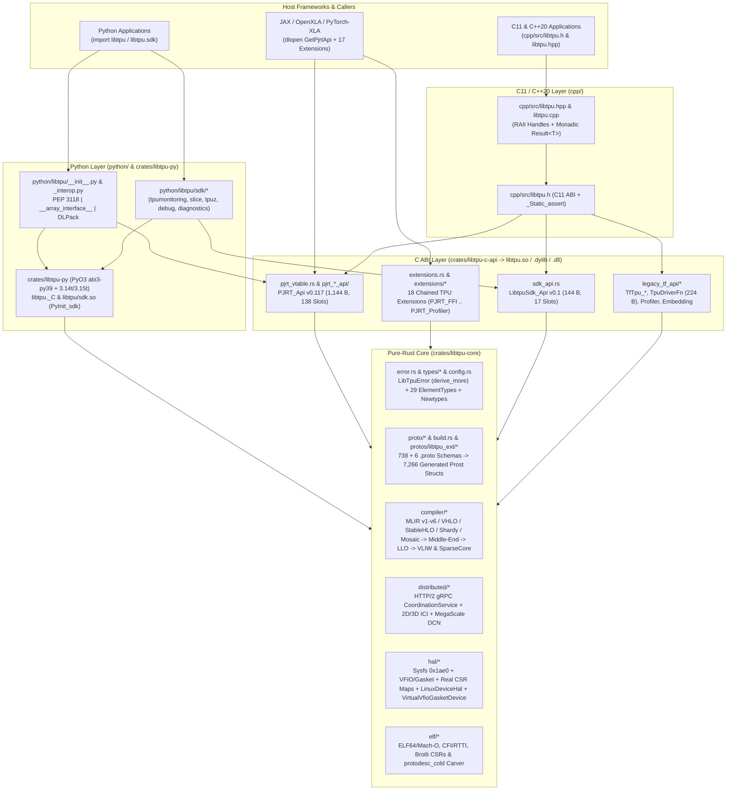

# `libtpu-rs` Architecture Guide

This document provides the ground-truth architectural reference for **`libtpu-rs`**, a pure-Rust, zero-external-C++-dependency, binary-ABI-exact re-implementation of Google Cloud's `libtpu.so` and `libtpu/sdk.so` (`v0.0.53.1`).

---

## Table of Contents

1. [Executive Summary & Design Philosophy](#1-executive-summary--design-philosophy)
2. [Workspace & Crate Dependency Graph](#2-workspace--crate-dependency-graph)
3. [Unified Error Model & Strong Domain Typing](#3-unified-error-model--strong-domain-typing)
4. [1:1 `.proto` <-> Rust `struct` Schema Architecture (`738` Schemas / `293` Domain Schemas)](#4-11-proto---rust-struct-schema-architecture-738-schemas--293-domain-schemas)
5. [Binary Forensics & Differential Oracle (`elf/*` & `scripts/*`)](#5-binary-forensics--differential-oracle-elf--scripts)
6. [Compiler Frontend, XLA-TPU Middle-End, LLO & VLIW/SparseCore Backend (`compiler/*`)](#6-compiler-frontend-xla-tpu-middle-end-llo--vliwsparsecore-backend-compiler)
7. [Linux Kernel Driver (`VFIO` & `Gasket`), Real CSR Maps & Hardware Emulator (`hal/*`)](#7-linux-kernel-driver-vfio--gasket-real-csr-maps--hardware-emulator-hal)
8. [Distributed Coordination, 2D/3D Twisted-Torus ICI & MegaScale DCN (`distributed/*`)](#8-distributed-coordination-2d3d-twisted-torus-ici--megascale-dcn-distributed)
9. [C11 ABI, 138-Slot `PJRT_Api` & 18-Node Extension Chain (`libtpu-c-api` & `cpp/src/libtpu.h`)](#9-c11-abi-138-slot-pjrt_api--18-node-extension-chain-libtpu-c-api--cppsrclibtpuh)
10. [Zero-Exception C++20 RAII & Monadic `Result<T>` SDK (`cpp/src/libtpu.hpp`)](#10-zero-exception-c20-raii--monadic-resultt-sdk-cppsrclibtpuhpp)
11. [Drop-In Python Wheel, `PyO3` (`abi3`) Extensions, DLPack & Live JAX (`libtpu-py` & `python/`)](#11-drop-in-python-wheel-pyo3-abi3-extensions-dlpack--live-jax-libtpu-py--python)
12. [Zero-Bypass 100% Doc & 100% Function/Line/Branch Coverage Gate (`scripts/pre_commit.py`)](#12-zero-bypass-100-doc--100-functionlinebranch-coverage-gate-scriptspre_commitpy)

---

## 1. Executive Summary & Design Philosophy

Google's closed-source `libtpu` Python wheel bundles two native shared libraries (`libtpu/libtpu.so` and `libtpu/sdk.so`) linking XLA-TPU, LLO, `asic_sw::driver`, MegaScale, and TensorFlow profiler runtimes behind C vtables (`GetPjrtApi`, `GetLibtpuSdkApi`, `TpuDriver_Open`, and `TfTpu_*`).

`libtpu-rs` replaces that binary cleanly while enforcing six non-negotiable engineering invariants across every module:

1. **100% Documentation Coverage (`INV-1`)**: Every file, module, struct/class/enum, variant, field, function, and parameter is documented across Rust (`rustdoc` `-D missing_docs` + AST `# Arguments` verifier), C11 & C++20 (`doxygen` `WARN_AS_ERROR = YES`, `WARN_NO_PARAMDOC = YES` + XML auditor), and Python (`ruff` `D` + AST `Args:`/`Returns:`/`Raises:` auditor).
2. **100% Function, Line, and Branch/Region Test Coverage (`INV-2`)**: Enforced across Rust (`cargo +nightly llvm-cov --workspace --branch`), C11/C++20 (`llvm-cov` + ASan/UBSan), and Python (`pytest --cov-branch --cov-fail-under=100`), with zero `coverage(off)` on production code and zero `# pragma: no cover`.
3. **Strong Domain Typing (`INV-3`)**: `#[repr(transparent)]` checked-arithmetic hardware/memory/ISA newtypes in Rust, `-fno-exceptions -fno-rtti` `enum class` / `std::span` / `Result<T>` in C++20, and `mypy --strict` + PEP 561 `.pyi` stubs in Python.
4. **Zero Panics or Unchecked Indexing (`INV-4`)**: Zero `.unwrap()`, `.expect()`, `panic!()`, `todo!()`, `unimplemented!()`, `unreachable!()`, or unchecked `slice[idx]`, plus 100% `ffi_catch_unwind` at every `extern "C"` boundary.
5. **Single Unified `derive_more` Error Enum (`INV-5`)**: Zero `anyhow` or `thiserror`; every fallible Rust function returns `Result<T, LibTpuError>` using the single workspace-wide `LibTpuError` enum in `crates/libtpu-core/src/error.rs`.
6. **1:1 `.proto` <-> `.rs` Synchronization (`INV-6`)**: All **738** reconstructed `.proto` schemas in `docs/reverse_engineering/protos/` together with the **6** pure-Rust extension schemas in `protos/libtpu_ext/` compile directly into the active Rust `prost` structs (`7,266` generated messages, `1,139` enums) with zero hand-written `*Proto` structs outside `OUT_DIR`.

---

## 2. Workspace & Crate Dependency Graph

---

## 3. Unified Error Model & Strong Domain Typing

- **Single `LibTpuError` (`crates/libtpu-core/src/error.rs`)**: Derived solely via `derive_more::{Display, Error, From}`, carrying structured context variants for binary forensics, protobuf wire/reflection errors, MLIR/VHLO/StableHLO/Shardy/Mosaic diagnostics, MSA OOM, LLO scheduling/register allocation, VLIW/SparseCore codecs, `VFIO`/`Gasket`/`dma-buf`/`mmap` syscalls, hardware CSR/ECC/watchdog faults, `CoordinationService`/ICI/MegaScale errors, and FFI struct-size/null-pointer checks. Converts losslessly to `PjrtErrorCode` (`0..=16`), `LibtpuSdkErrorCode`, `tensorflow.StatusProto`, `MegaScaleRuntimeError`, and `PJRT_Error_ForEachPayload`.
- **Hardware, Memory & ISA Newtypes (`crates/libtpu-core/src/types/`)**:
  - `#[repr(transparent)]` checked-arithmetic types: `PcieDomainBusDevFn`, `PcieVendorId`, `PcieDeviceId`, `BarIndex`, `MmioOffset`, `IovaAddress`, `HbmAddress`, `VmemAddress`, `SmemAddress`, `CmemAddress`, `SpMemAddress`, `ImemPc`, `SregIndex`, `VregIndex`, `MregIndex`, `PredRegIndex`, `SyncFlagIndex`, `SublaneCount`, `LaneCount`, `CoreId`, `ChipId`, `HostId`, `SliceId`, `TaskId`, `CommunicatorId`, and `ChannelId`.
  - Exact scalar codecs, sub-byte lane packing/unpacking, NaN/Inf handling, and stochastic rounding across all **29 OpenXLA `ElementType`s** (including `S2`/`U2`, `S4`/`U4`, FP4 `F4E2M1FN`, FP8 `F8E4M3FN` / `F8E5M2` / `F8E4M3B11FNUZ` / `F8E4M3FNUZ` / `F8E5M2FNUZ` / `F8E8M0FNU`, `BF16`, `F16`, `F32`, `F64`, `C64`, `C128`).

---

## 4. 1:1 `.proto` <-> Rust `struct` Schema Architecture (`738` Schemas / `293` Domain Schemas)

`docs/reverse_engineering/protos/` contains all **738** `.proto` files reconstructed verbatim from `libtpu.so`'s embedded `protodesc_cold` descriptor pool (covering the **293** TPU/XLA/HLO/PJRT/Shardy/DeepSea/BarnaCore/MegaScale/XPlane/CoordinationService domain catalog schemas plus all transitive Google/Protobuf/RPC/TF imports), complemented by `protos/libtpu_ext/*.proto` (**6** pure-Rust extension schemas for HLO passes, Shardy/Mosaic/LLO metadata, MegaScale, and XPlane profiler RPCs).

- **Dual-Root Single Source of Truth (`crates/libtpu-core/build.rs`)**: Preserves the exact **738**-file `PROTODESC_COLD_293_CATALOG` forensic manifest while compiling all **744** `.proto` files via `protox` + `prost-build` into `OUT_DIR` (`generated_prost_schemas`, **7,266** message structs, **1,139** enums) and auto-generating `ProtoSchemaMessage` implementations (`full_name()`, `descriptor()`, binary `encode`/`decode`, canonical ProtoJSON transcode, textproto transcode, SHA-256 & HighwayHash64 fingerprinting).
- **Zero Duplicate Structs**: `crates/libtpu-core/src/proto/{descriptor,xla_data,hlo,pjrt,tpu,deepsea,megascale,xplane}.rs` re-export and operate directly on the generated `prost` types; `scripts/pre_commit.py proto-sync` forbids any manual `#[derive(prost::Message)]` or hand-written `pub struct *Proto` / `pub enum *Proto` outside `OUT_DIR` and verifies 1:1 field/tag bijection.

---

## 5. Binary Forensics & Differential Oracle (`elf/*` & `scripts/*`)

- **`elf/proto_carver.rs` & `scripts/re_extract.py`**: Carves `protodesc_cold` wire-format `FileDescriptorProto` blobs, verifies topological dependency closure, and validates round-trip `FileDescriptorSet` parity (`golden_proto_descriptors.json`).
- **`elf/carver.rs` & `csr_register_map.json`**: Scans `FileToc` tables (verifying 16-byte MD5 checksums) and decompresses embedded Brotli (`*_pf_csrs.br`, `*_error_collector_error_sources.br`) hardware register maps plus **194,929** static `.lrodata` CSR descriptors across Cloud TPU `v2` (`jf`), `v3` (`df`), `v4`/`v4lite` (`pf`), `v5e`/`v5p` (`vf`), `v6e` (`gf`), and `v7x` (`iw`).
- **`elf/symbols.rs`, `elf/relocations.rs`, `elf/disassembler.rs` & `scripts/ghidra_lift_isa_and_abi.py`**: Decodes Itanium C++ ABI RTTI (`_ZTI*`, `_ZTV*`), `.eh_frame` / `.eh_frame_hdr` CIE/FDE records (`x86_64` & `aarch64`), dynamic vtable relocations, `PJRT_*_Args` `struct_size` prologues, VLIW slot encodings, and `Gasket`/`VFIO` ioctls.
- **`scripts/differential_oracle.py`, `fetch_artifacts.py` & `sync_oss_anchors.py`**: Deterministic PyPI `libtpu` wheel verifier/differ, OpenXLA/LLVM/StableHLO/Shardy/JAX/Linux UAPI anchor synchronizer, and AOT compiler + `LD_PRELOAD` MMIO trace differential oracle.

---

## 6. Compiler Frontend, XLA-TPU Middle-End, LLO & VLIW/SparseCore Backend (`compiler/*`)

1. **MLIR Bytecode v1–v6 & Multi-Dialect Frontend (`compiler/mlir_bytecode/*`, `parser.rs`, `hlo_parser.rs`, `chlo.rs`, `hlo_bridge.rs`)**:
   - Exact `ML\xefR` v1–v6 `DialectBytecodeReader` / `DialectBytecodeWriter` supporting `builtin`, `vhlo` (`v0.9.0`–`v1.11.0+` upgrade/downgrade portable artifacts), `stablehlo`, `chlo` decomposition, `sdy` (Shardy meshes & shardings), and JAX `tpu` (Mosaic `#tpu.tiled`, `#tpu.memory_space`, `tpu.matmul`, `tpu.enqueue_dma`/`wait_dma`, semaphore ops, `vector.*`, `scf.*`), alongside textual MLIR, XLA HLO text, and binary `xla::HloModuleProto`.
2. **XLA-TPU Middle-End Optimizer & Memory Space Assignment (`compiler/middle_end/*`, `passes.rs`)**:
   - `ShardyPropagationPass` & `GspmdPartitionerPass` synthesizing `AllReduce`, `ReduceScatter`, `AllGather`, `AllToAll`, `CollectivePermute`, and `RaggedAllToAll`.
   - `DotDecomposerPass`, `ConvolutionLegalizerPass`, algebraic/constant/broadcast/reshape/transpose/tuple/LICM/CSE/DCE passes, `AsyncCollectiveFusionPass`, and `LatencyHidingSchedulerPass`.
   - `TpuLayoutAssignmentPass` (`(8, 128)` / `(4, 128)` / `(2, 128)` `TileProto` layouts + sub-32-bit lane packing), `MxuTilingPass` (`128x128` `v2`–`v5p` and `256x256` `v6e`/`v7x`), `TpuProducerConsumerFusionPass`, `MultiOutputFusionPass`, and `HloRematerializationPass`.
   - `MemorySpaceAssignmentPass` (HBM `0`, VMEM `1`, SMEM `2`, CMEM `3` + ping-pong async `CopyStart`/`CopyDone`), `GlobalDecreasingSizeBestFitHeapSimulator` (`BufferAssignmentProto` + buffer donation/aliasing), and `LearnedCostModelEvaluator`.
3. **LLO & Multi-Generation Binary VLIW / SparseCore Backend (`compiler/llo/*`, `compiler/isa/*`, `compiler/sparsecore/*`, `serialization.rs`)**:
   - `LloIr` across `(S0, S1, V0, V1/EUP, MXU0..3, XLU0..1, DMA, IMM)` slots, `SwingModuloPipeliner`, and `LloRegisterAllocator` (`SREG`, `VREG`, `MREG`, `PREG`, `SyncFlag` banks with VMEM/SMEM spill insertion).
   - Generation-exact binary VLIW encoders & disassemblers: `JellyfishIsaCodec` (`jfc`, v2), `DragonfishIsaCodec` (`dfc`, v3), `PufferfishIsaCodec` (`pfc`, v4/v4lite), `ViperfishIsaCodec` (`vfc`, v5e/v5p), `GhostfishIsaCodec` (`gfc`, v6e Trillium), and `IronwoodIsaCodec` (`iwc`, v7x Ironwood).
   - **SparseCore / BarnaCore V2 & V3**: Binary instruction codecs, SPMEM tiling, COO/CSR sorting, embedding gather/dedup, and all **19 gradient optimizers**.
   - Wire-exact `TpuExecutableProto` / `DeepseaExecutableProto` / `IsaProgramProto` packaging (Riegeli HighwayHash64 framing, `ProgramRelocation`, `HostCommandEnvelopeProto`, XDB HLO-to-LLO PC mappings) and 5-phase `PJRT_PhaseCompile` (`PjRtPartialProgramProto`).

---

## 7. Linux Kernel Driver (`VFIO` & `Gasket`), Real CSR Maps & Hardware Emulator (`hal/*`)

- **PCIe `0x1ae0` Sysfs Discovery & IOMMU (`hal/pcie.rs`, `hal/iommu.rs`)**: Enumerates `/sys/bus/pci/devices/*` (`0x0027` v2/v3, `0x0056` v4, `0x005e` v4lite, `0x0063` v5e, `0x0062` v5p, `0x006f` v6e, `0x0076`/`0x007f`/`0x0073` v7x), manages `VFIO` (`0x3B`, `VFIO_TYPE1v2_IOMMU`, BAR `mmap`, MSI-X `VFIO_DEVICE_SET_IRQS`) and `Gasket` (`0xDC`, page-table partitioning, `MAP_BUFFER`, `MAP_DMABUF`, `SET_EVENTFD`) lifecycles, buddy/slab HBM allocation, hugepage staging pools, and zero-copy `dma-buf` import/export.
- **Non-Simulated `LinuxDeviceHal` (`hal/linux.rs`)**: Performs real IMEM relocation, H2D DMA descriptor ring enqueueing, BAR0/GCSR TensorCore & SparseCore CSR initialization using authentic `csr_register_map.json` offsets, asynchronous MSI-X `eventfd` completion (`PJRT_Event_OnReady`), `HostCommandEnvelopeProto` host-callback servicing, ECC/watchdog fault decoding, and hardware XPlane harvesting.
- **Cycle-Accurate `VirtualVfioGasketDevice` (`hal/emulator/*`)**: Standalone virtual PCIe/VFIO/Gasket kernel backend trapping exact `VFIO`/`Gasket` ioctls and BAR0/BAR2 MMIO doorbells, decoding and executing the real generation-specific binary VLIW & SparseCore bitstreams from IMEM/HBM across `[8, 128]` vector lanes and `128x128`/`256x256` MXU systolic arrays, and signaling OS `eventfd`s.

---

## 8. Distributed Coordination, 2D/3D Twisted-Torus ICI & MegaScale DCN (`distributed/*`)

- **`CoordinationService` (`distributed/coordination.rs`)**: Wire-compatible HTTP/2 + Protobuf gRPC client and server implementing all **19** `tensorflow.CoordinationService` RPCs (`RegisterTask`, `WaitForAllTasks`, `Heartbeat`, `InsertKeyValue`, `GetKeyValue`, `TryGetKeyValue`, `IncrementKeyValue`, `GetKeyValueDir`, `DeleteKeyValue`, `Barrier`, `CancelBarrier`, `ReportErrorToTask`, `ReportErrorToService`, `GetTaskState`, `WatchJobState`, `GetAliveTasks`, `PollForError`, `ResetTask`, `ShutdownTask`) and `LocalTopologyProto` -> `GlobalTopologyProto` discovery.
- **2D/3D Twisted-Torus ICI Router (`distributed/ici.rs`)**: Deadlock-free 2D torus (`v2`/`v3`/`v5e`/`v6e`) and 3D twisted-torus (`v4`/`v5p`/`v7x`) routing with link-health bypass and multi-ring / mesh-torus / Halving-Doubling collectives across all 29 `ElementType`s.
- **MegaScale Multi-Slice Runtime (`distributed/megascale.rs`)**: Asynchronous multi-socket TCP/DCN transport, hierarchical `DCN`+`ICI` collectives, congestion pacing (`MegascaleCongestionControlConfigProto`), `MegaScaleActionGraph` execution, and `MegaScaleRuntimeError` / `RapidEyeInfo` telemetry.

---

## 9. C11 ABI, 138-Slot `PJRT_Api` & 18-Node Extension Chain (`libtpu-c-api` & `cpp/src/libtpu.h`)

- **Panic-Free & Strongly-Typed Handle Registries**: Every `extern "C"` entrypoint is wrapped in `ffi_catch_unwind` over exact `#[repr(C)]` `*_Args` structs and registered live handle tables, with lifetime-bound arenas owned by `PJRT_Client`, `PJRT_Executable`, or `PJRT_TopologyDescription`.
- **`PJRT_Api` v0.117 (`1,144` B, 138 Slots)**: Verified slot-for-slot via Rust `offset_of!`, C11 `_Static_assert` (`cpp/tests/test_libtpu_c11.c`), and C++20 `static_assert` (`cpp/src/libtpu.cpp`).
- **18-Node `PJRT_Extension_Base` Chain (`GetPjrtApi()->extension_start`)**:

| Order | Extension Struct | `ext_type` | Size (Bytes) | Function Slots |
| :---: | :--- | :---: | :---: | :---: |
| 1 | `PJRT_FFI_Extension` | `5` (`0x05`) | `48` | `3` |
| 2 | `PJRT_XlaTransform_Extension` | `24` (`0x18`) | `56` | `4` |
| 3 | `PJRT_HostMemoryAllocator_Extension` | `23` (`0x17`) | `32` | `1` |
| 4 | `PJRT_MultiSlice_Extension` | `22` (`0x16`) | `64` | `5` |
| 5 | `PJRT_Collectives_Extension` | `21` (`0x15`) | `96` | `9` |
| 6 | `PJRT_AbiVersion_Extension` | `20` (`0x14`) | `120` | `12` |
| 7 | `PJRT_Shardings_Extension` | `19` (`0x13`) | `40` | `2` |
| 8 | `PJRT_Megascale_Extension` | `18` (`0x12`) | `288` | `33` |
| 9 | `PJRT_TpuExecutable_Extension` | `17` (`0x11`) | `96` | `9` |
| 10 | `PJRT_TpuTopology_Extension` | `16` (`0x10`) | `280` | `32` |
| 11 | `PJRT_Callback_Extension` | `14` (`0x0e`) | `40` | `2` |
| 12 | `PJRT_PhaseCompile_Extension` | `9` (`0x09`) | `192` | `21` |
| 13 | `PJRT_CrossHostTransfers_Extension` | `12` (`0x0c`) | `56` | `4` |
| 14 | `PJRT_ExecutableMetadata_Extension` | `13` (`0x0d`) | `40` | `2` |
| 15 | `PJRT_MemoryDescriptions_Extension` | `6` (`0x06`) | `40` | `2` |
| 16 | `PJRT_Layouts_Extension` | `4` (`0x04`) | `80` | `7` |
| 17 | `PJRT_RawBuffer_Extension` | `8` (`0x08`) | `80` | `7` |
| 18 | `PJRT_Profiler_Extension` | `1` (`0x01`) | `40` | `2` (`PLUGIN_Profiler_Api` `104` B, `11` slots + header) |

- **Additional C Vtables & Unified Telemetry (`SharedTpuRuntimeState`)**: `LibtpuSdk_Api` v0.1 (`144` B, 17 slots), `TpuDriverFn` (`224` B, 28 slots), `TfTpu_*`, `TpuTopology_*`, `TpuProfiler_*`, `TpuEmbeddingEngine_*` (75 `libtpu.so` dynamic exports + `PyInit_sdk`), and ergonomic `libtpu_rs_*` C helpers—all unified over `libtpu_core::runtime_state::SharedTpuRuntimeState`.

---

## 10. Zero-Exception C++20 RAII & Monadic `Result<T>` SDK (`cpp/src/libtpu.hpp`)

Built via two-level CMake (`cpp/CMakeLists.txt` + `cpp/src/CMakeLists.txt`) under `-std=c++20 -Wall -Wextra -Wpedantic -Wconversion -Wsign-conversion -fno-exceptions -fno-rtti -Werror`:
- **`libtpu::Status` & `libtpu::Result<T>`**: `[[nodiscard]]`, move-safe, zero-exception value/status container providing `.value()`, `.value_or()`, `.map()`, and `.and_then()`.
- **Complete RAII Handle Suite**: `Plugin`, `TopologyDescription`, `DeviceDescription`, `Client`, `Device`, `Memory`, `Buffer`, `RawBuffer`, `AsyncTransferManager`, `CopyToDeviceStream`, `DlPackTensor`, `Executable`, `LoadedExecutable`, `PhaseCompiler`, `XlaTransform`, `ExecuteContext`, `Event`, `CollectiveCommunicator`, `MegaScaleContext`, `MultiSliceConfig`, `FfiCustomCallRegistry`, `Profiler`, `EmbeddingEngine`, and `SdkClient`.

---

## 11. Drop-In Python Wheel, `PyO3` (`abi3` + Free-Threaded) Extensions, DLPack & Live JAX (`libtpu-py` & `python/`)

- **Native `PyO3` (`abi3-py39` + PEP 703 `Py_MOD_GIL_NOT_USED`) Extensions (`crates/libtpu-py`)**: Exports both `libtpu._C` (`PyInit__C`) and `libtpu/sdk.so` (`PyInit_sdk`) for Python `>=3.9` through `3.15` (including free-threaded `cp314t`/`cp315t`), synchronizing telemetry with `libtpu.so` via `ExternalRuntimeSyncVtable`, mapping `LibTpuError` to typed `libtpu.TpuError` exceptions, and constructing `PyCapsule("dltensor")` zero-copy views (`dlpack.rs`).
- **Custom PEP 517 Maturin Backend (`scripts/maturin_backend.py`)**: Packages `libtpu/libtpu.so`, `libtpu/sdk.so`, and `libtpu/_C` into a single drop-in `pip install .` wheel, automatically switching from `abi3-py39` to `--no-default-features --features=extension-module,freethreaded` when `Py_GIL_DISABLED == 1`.
- **Zero-Copy Tensor Protocols (`python/libtpu/_interop.py`)**: Full PEP 3118 buffer protocol, NumPy `__array_interface__` (including `ml_dtypes` `bfloat16`, `float8_*`, `int4`/`uint4`), and DLPack (`__dlpack__`, `__dlpack_device__`, `from_dlpack`).
- **Live End-to-End `jax` Validation (`python/tests/test_jax_integration.py`)**: Boots real `jax` over `libtpu-rs` (`LinuxDeviceHal<VirtualVfioGasketDevice>`) and verifies numerical parity against JAX CPU across `jnp.matmul` (`f32`/`bf16`), `lax.dot_general`, `lax.conv_general_dilated`, `jax.jit`/`grad`/`vmap`, `lax.scan`/`while_loop`/`cond`, 4-chip `shard_map` collectives, `pallas_call` Mosaic kernels, `jax.pure_callback`, Transformer SGD steps, and `jax.profiler` `XPlane` capture.

---

## 12. Zero-Bypass 100% Doc & 100% Function/Line/Branch Coverage Gate (`scripts/pre_commit.py`)

`scripts/pre_commit.py all --check` (and `.github/workflows/ci.yml`) executes 7 deterministic stages:

1. **`fmt`**: `cargo fmt --all -- --check`, `ruff format --check`, and `clang-format --dry-run --Werror` across `.h`, `.hpp`, `.c`, and `.cpp`.
2. **`build`**: `cargo build --workspace --all-targets` and `cmake -B cpp/build -S cpp -DENABLE_COVERAGE=ON && cmake --build cpp/build`.
3. **`clippy` (`lint`)**: Strictest workspace Clippy (`-D warnings`), `cargo doc` (`-D missing_docs -D rustdoc::broken_intra_doc_links`), `ruff check` (`D` Google pydocstyle), `mypy --strict`, `doxygen` (`WARN_AS_ERROR = YES`, `WARN_NO_PARAMDOC = YES`), and AST auditors banning `unwrap`/`expect`/`panic`/`anyhow`/`thiserror`/`allow(dead_code)`/`coverage(off)`/`pragma: no cover` and verifying `# Arguments` / `Args:` / `@param` completeness.
4. **`abi`**: Source & `ctypes.CDLL` binary verification of all 79 exported symbols, `PJRT_Api` (1,144 B, 138 slots), 17 PJRT extensions, `LibtpuSdk_Api` (144 B), and `TpuDriverFn` (224 B).
5. **`proto-sync`**: Bidirectional AST + `prost-build` verification across all 744 `.proto` files (`738` `protodesc_cold` + `6` `protos/libtpu_ext/`) and 7,266 generated Rust message structs.
6. **`test`**: `cargo test --workspace --all-targets`, `pytest --cov=libtpu --cov=scripts --cov-branch --cov-fail-under=100` (including live `jax`), and `ctest --test-dir cpp/build` (`test_libtpu` + `test_libtpu_c11`, plus ASan/UBSan in CI).
7. **`shields`**: Enforces **100.0% doc coverage** and **100.0% function, line, and branch/region test coverage** across Rust, Python, and C11/C++20, verifying `README.md` shields are up to date.
