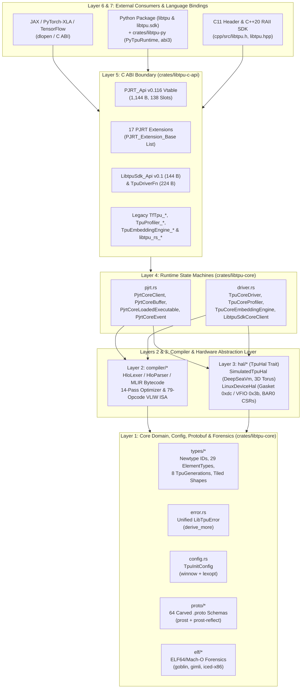
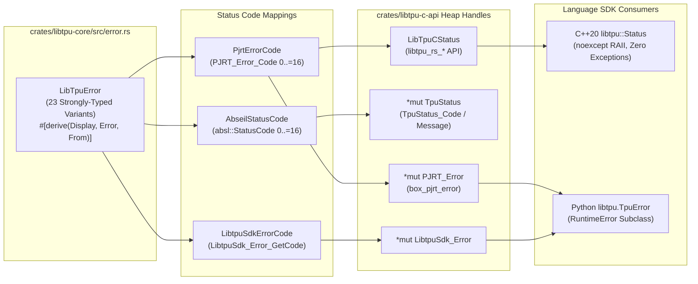
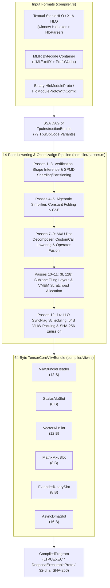
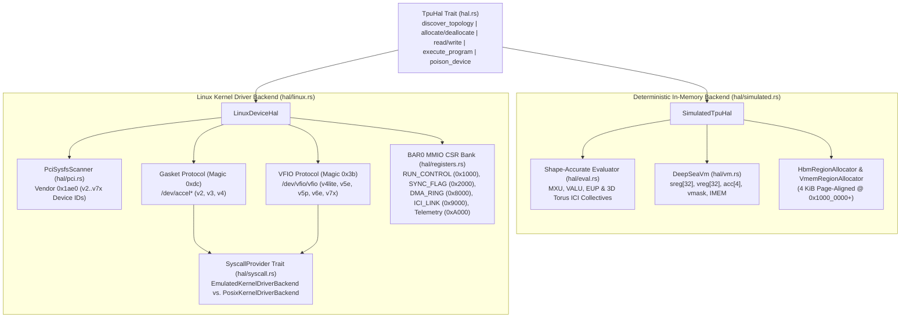
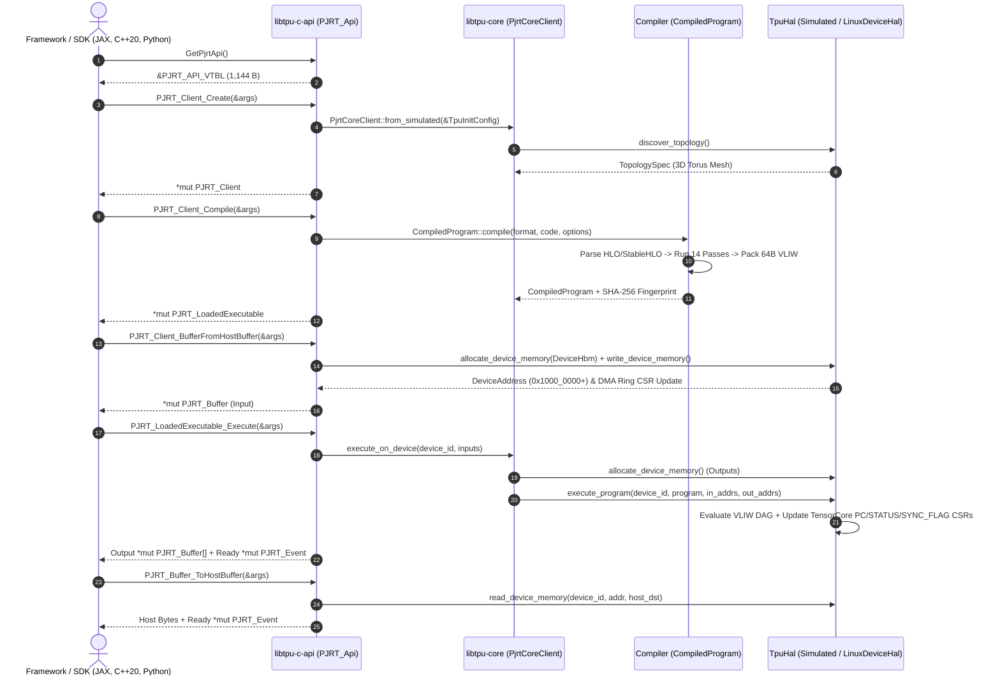
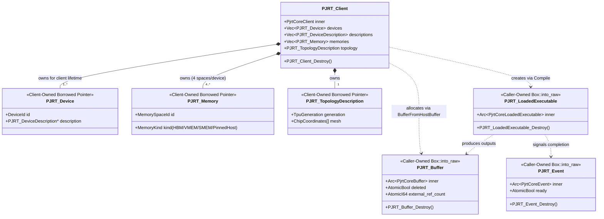

# `libtpu-rs` Architecture Guide

This document provides an exhaustive architectural reference for **`libtpu-rs`**, a pure-Rust, zero-external-C++-dependency, ABI-compatible re-implementation of Google Cloud's `libtpu.so` (`v0.0.50`, `PJRT_Api` v0.116) and `libtpu/sdk/sdk.so` (`LibtpuSdk_Api` v0.1), paired with C11 headers, a zero-exception C++20 RAII SDK, and a drop-in Python wheel package (`libtpu` + `libtpu.sdk`).

---

## Table of Contents

1. [System Overview & Design Philosophy](#1-system-overview--design-philosophy)
2. [Workspace & Directory Layout](#2-workspace--directory-layout)
3. [Multi-Layered System Architecture](#3-multi-layered-system-architecture)
4. [Layer 1: Core Domain, Forensics & Unified Error Model (`libtpu-core`)](#4-layer-1-core-domain-forensics--unified-error-model-libtpu-core)
   - [4.1 Strongly-Typed Domain Primitives (`types.rs` & `types/*`)](#41-strongly-typed-domain-primitives-typesrs--types)
   - [4.2 Unified Error Hierarchy (`error.rs`)](#42-unified-error-hierarchy-errorrs)
   - [4.3 Runtime Configuration & Environment Parser (`config.rs`)](#43-runtime-configuration--environment-parser-configrs)
   - [4.4 Schema-Reflected Protobuf Wire Codec (`proto.rs` & `proto/*`)](#44-schema-reflected-protobuf-wire-codec-protors--proto)
   - [4.5 Clean-Room ELF64/Mach-O Binary Forensics (`elf.rs` & `elf/*`)](#45-clean-room-elf64mach-o-binary-forensics-elfrs--elf)
5. [Layer 2: HLO & StableHLO Compiler Pipeline (`compiler.rs` & `compiler/*`)](#5-layer-2-hlo--stablehlo-compiler-pipeline-compilerrs--compiler)
   - [5.1 Input Formats, MLIR Bytecode & `winnow` Frontend (`lexer.rs`, `mlir_bytecode.rs`)](#51-input-formats-mlir-bytecode--winnow-frontend-lexerrs-mlir_bytecoders)
   - [5.2 VLIW Instruction Bundle ISA (`opcode.rs` & `vliw.rs`)](#52-vliw-instruction-bundle-isa-opcoders--vliwrs)
   - [5.3 Fourteen-Pass Lowering, Liveness & Optimization Pipeline (`passes.rs`)](#53-fourteen-pass-lowering-liveness--optimization-pipeline-passesrs)
   - [5.4 Phased Compilation (`PJRT_PhaseCompile_Extension`)](#54-phased-compilation-pjrt_phasecompile_extension)
   - [5.5 Cost Analysis, Memory Stats, SHA-256 Fingerprinting & Serialization (`serialization.rs`)](#55-cost-analysis-memory-stats-sha-256-fingerprinting--serialization-serializationrs)
6. [Layer 3: Hardware Abstraction Layer (`hal.rs` & `hal/*`)](#6-layer-3-hardware-abstraction-layer-halrs--hal)
   - [6.1 The `TpuHal` Trait Contract](#61-the-tpuhal-trait-contract)
   - [6.2 Deterministic In-Memory Simulator (`SimulatedTpuHal`, `eval.rs` & `vm.rs`)](#62-deterministic-in-memory-simulator-simulatedtpuhal-evalrs--vmrs)
   - [6.3 Linux Kernel Driver Backend (`LinuxDeviceHal`, `pci.rs`, Gasket & VFIO)](#63-linux-kernel-driver-backend-linuxdevicehal-pcirs-gasket--vfio)
   - [6.4 PCIe BAR0 MMIO Control & Status Register (CSR) Map (`registers.rs`)](#64-pcie-bar0-mmio-control--status-register-csr-map-registersrs)
   - [6.5 Injectable OS System Call Interface (`syscall.rs`)](#65-injectable-os-system-call-interface-syscallrs)
7. [Layer 4: PJRT & Legacy Runtime Engines (`pjrt.rs` & `driver.rs`)](#7-layer-4-pjrt--legacy-runtime-engines-pjrtrs--driverrs)
   - [7.1 PJRT Core Domain Engine (`pjrt.rs`)](#71-pjrt-core-domain-engine-pjrtrs)
   - [7.2 Legacy TensorFlow, Driver, Profiler, Embedding & SDK Engines (`driver.rs`)](#72-legacy-tensorflow-driver-profiler-embedding--sdk-engines-driverrs)
8. [Layer 5: C ABI & Binary Layout (`libtpu-c-api`)](#8-layer-5-c-abi--binary-layout-libtpu-c-api)
   - [8.1 `PJRT_Api` v0.116 Vtable (`1,144` Bytes, 138 Slots)](#81-pjrt_api-v0116-vtable-1144-bytes-138-slots)
   - [8.2 The 17-Node TPU PJRT Extension Linked List (`extensions.rs` & `extensions/*`)](#82-the-17-node-tpu-pjrt-extension-linked-list-extensionsrs--extensions)
   - [8.3 `LibtpuSdk_Api` v0.1 Vtable (`144` Bytes, 17 Slots)](#83-libtpusdk_api-v01-vtable-144-bytes-17-slots)
   - [8.4 Legacy `TfTpu_*`, `TpuDriver_*`, `TpuProfiler_*` & `TpuEmbeddingEngine_*` C Symbols](#84-legacy-tftpu_-tpudriver_-tpuprofiler_--tpuembeddingengine_-c-symbols)
   - [8.5 Ergonomic `libtpu_rs_*` C Entrypoints](#85-ergonomic-libtpu_rs_-c-entrypoints)
9. [Layer 6: C11 Header & C++20 RAII SDK (`cpp/`)](#9-layer-6-c11-header--c20-raii-sdk-cpp)
   - [9.1 C11 Header (`cpp/src/libtpu.h`)](#91-c11-header-cppsrclibtpu-h)
   - [9.2 Zero-Exception C++20 RAII Wrappers (`cpp/src/libtpu.hpp` & `libtpu.cpp`)](#92-zero-exception-c20-raii-wrappers-cppsrclibtpu-hpp--libtpucpp)
10. [Layer 7: Python Wheel Package & SDK (`libtpu-py` & `python/libtpu/`)](#10-layer-7-python-wheel-package--sdk-libtpu-py--pythonlibtpu)
    - [10.1 Rust Python Bridge & `CPython` Stable ABI (`crates/libtpu-py`)](#101-rust-python-bridge--cpython-stable-abi-crateslibtpu-py)
    - [10.2 Top-Level `libtpu` Python Module (`python/libtpu/__init__.py`)](#102-top-level-libtpu-python-module-pythonlibtpu__init__py)
    - [10.3 `libtpu.sdk` Subpackage (`tpumonitoring`, `slice`, `tpuz`, `debug`)](#103-libtpusdk-subpackage-tpumonitoring-slice-tpuz-debug)
11. [End-to-End Data & Control Flows](#11-end-to-end-data--control-flows)
    - [11.1 Client Initialization & Topology Discovery](#111-client-initialization--topology-discovery)
    - [11.2 Program Compilation (`StableHLO` / `HloModuleProto` -> `LoadedExecutable`)](#112-program-compilation-stablehlo--hlomoduleproto---loadedexecutable)
    - [11.3 Host-to-Device DMA, VLIW Execution & Device-to-Host Readback](#113-host-to-device-dma-vliw-execution--device-to-host-readback)
12. [Concurrency, Memory Safety & Lifetime Model](#12-concurrency-memory-safety--lifetime-model)
13. [Quality Standards & Verification Pipeline (`scripts/pre_commit.py`)](#13-quality-standards--verification-pipeline-scriptspre_commitpy)

---

## 1. System Overview & Design Philosophy

Google Cloud's proprietary `libtpu.so` is a monolithic ~631 MB shared library linking XLA, LLVM, MLIR, Abseil, gRPC, Protobuf, and low-level kernel driver clients (`asic_sw::driver`). Frameworks such as **JAX**, **PyTorch/XLA**, and **TensorFlow** interact with `libtpu.so` strictly across well-defined C ABI boundaries (`GetPjrtApi`, `GetLibtpuSdkApi`, `TfTpu_*`, `TpuDriver_*`, `TpuProfiler_*`, and `TpuEmbeddingEngine_*`).

`libtpu-rs` re-implements the complete surface area of `libtpu.so` and `libtpu/sdk/sdk.so` in safe, idiomatic Rust with the following architectural invariants:

1. **100% Binary ABI Compatibility**: Every exported C symbol, vtable offset, struct size, alignment padding byte, and extension type discriminant matches the reverse-engineered `libtpu-0.0.50` binary (`PJRT_Api` v0.116 = `1,144` bytes; `LibtpuSdk_Api` v0.1 = `144` bytes; `TpuDriverFn` = `224` bytes), verified via compile-time `const _: () = assert!(...)` assertions.
2. **Pure-Rust, Zero External C/C++ Runtime Dependencies**: No closed-source blobs or external C++ libraries (such as `libprotobuf`, LLVM, or Abseil) are linked. Instead, `libtpu-core` uses a curated set of pure-Rust crates:
   - **Protobuf & Schema Reflection**: `prost`, `prost-reflect`, `prost-types`, and build-time `protox` / `prost-build` (compiling the 64 carved `.proto` schemas into a static `FileDescriptorSet`).
   - **Parsing & CLI**: `winnow` (combinator parsing for HLO/StableHLO and mesh bounds) and `lexopt` (`LIBTPU_INIT_ARGS` CLI flag parsing).
   - **Hardware Numerics & Layouts**: `half` (`f16` / `bf16`), `float8`, `num-complex`, `bytemuck` (zero-copy `Pod` / `Zeroable` VLIW bundles and CSR maps), `bitflags`, `num_enum`, and `derive_more`.
   - **Compiler Graph & Hashing**: `petgraph` (topological sorting and cycle detection on HLO DAGs), `indexmap`, `smallvec`, `sha2` (SHA-256 executable fingerprinting), `blake3`, and `brotli`.
   - **ELF64 / Mach-O Binary Forensics**: `goblin`, `object`, `gimli` (`.eh_frame` DWARF unwinding), `iced-x86` (`x86_64` disassembly and CFG construction), `cpp_demangle`, `serde`, and `serde_json`.
   - **Concurrency & OS Interfaces**: `parking_lot` (fast, non-poisoning mutexes), `libc`, `nix`, `rustix`, and `memmap2`.
3. **Deterministic Hardware Simulation Everywhere**: A cycle- and shape-accurate `SimulatedTpuHal`, `DeepSeaVm` (`TpuCoreVmState`), and `EmulatedKernelDriverBackend` allow multi-host TPU pods (`v2`, `v3`, `v4`, `v4lite`, `v5e`, `v5p`, `v6e`, `v7x`), ICI collectives, HBM/VMEM/SMEM/CMEM capacity limits, BAR0 MMIO CSRs, and Gasket/VFIO `ioctl` page tables to be tested deterministically on macOS, Linux, and Windows without physical TPU PCIe cards.
4. **Strict Safety & Quality Enforcement**:
   - Zero `.unwrap()`, `.expect()`, `panic!`, or `todo!` calls across all library and test code (`clippy::unwrap_used = "forbid"`, `clippy::expect_used = "forbid"`, `clippy::panic = "forbid"`, `clippy::todo = "forbid"`).
   - Single workspace-wide error enum (`LibTpuError`) powered by `derive_more` (`From`, `Display`, `Error`) — no `anyhow` or stringly-typed error erasure.
   - `missing_docs = "forbid"`, `unsafe_op_in_unsafe_fn = "forbid"`, `missing_safety_doc = "deny"`, and `undocumented_unsafe_blocks = "deny"`.
   - 100% documentation coverage and 100% line/function/branch test coverage across Rust (including `proptest` property suites), Python, and C++20.

---

## 2. Workspace & Directory Layout

```text
libtpu-rs/
├── Cargo.toml                         # Rust workspace manifest & strict rustc/clippy lint table
├── pyproject.toml                     # Python package, ruff, mypy (--strict), and pytest config
├── README.md                          # User-facing overview, quickstart, and coverage shields
├── USAGE.md                           # Comprehensive usage & framework integration guide
├── ARCHITECTURE.md                    # This architectural reference document
├── crates/
│   ├── libtpu-core/                   # Pure-Rust domain engine, compiler, HAL, PJRT & driver core
│   │   ├── Cargo.toml
│   │   ├── build.rs                   # Compiles 64 .proto schemas into FileDescriptorSet via protox/prost
│   │   └── src/
│   │       ├── lib.rs                 # Crate root & workspace source invariants test
│   │       ├── elf.rs                 # ELF64/Mach-O forensics module root & re-exports
│   │       ├── elf/
│   │       │   ├── carver.rs          # protodesc_cold Protobuf carver, .proto renderer & filewrapper_toc
│   │       │   ├── disassembler.rs    # iced-x86 prologue analyzer, CFG builder & ioctl callsite scanner
│   │       │   ├── manifest.rs        # SHA-256/BLAKE3 digests & golden binary/layout manifest parsers
│   │       │   ├── relocations.rs     # .rela.dyn resolver & PJRT/SDK/Driver/Itanium C++ vtable reconstructors
│   │       │   └── symbols.rs         # goblin/object symbol inspector, gimli .eh_frame & C++ demangler
│   │       ├── error.rs               # Unified LibTpuError enum & PJRT/Abseil/SDK status codes
│   │       ├── types.rs               # Domain primitives module root & re-exports
│   │       ├── types/
│   │       │   ├── address.rs         # Memory addresses, sizes, alignments & PCIe/kernel primitives
│   │       │   ├── element.rs         # 29-variant ElementType (PJRT_Buffer_Type) & f16/bf16/f8/sub-byte codecs
│   │       │   ├── enums.rs           # Runtime, PJRT, DMA, collective, routing & memory space enums
│   │       │   ├── hardware.rs        # 8-variant TpuGeneration, TpuCoreTypeEnum & 3D torus ChipCoordinates
│   │       │   ├── ids.rs             # Newtype IDs (derive_more) for topology, handles & TensorCore registers
│   │       │   └── shape.rs           # MemoryLayout, Shape (TPU tile permutation) & TypedDeviceBuffer
│   │       ├── config.rs              # TpuInitConfig & winnow/lexopt LIBTPU_INIT_ARGS / env parser
│   │       ├── proto.rs               # Protobuf codec & prost_reflect DescriptorPool module root
│   │       ├── proto/
│   │       │   ├── deepsea.rs         # IsaProgramProto, TargetArgumentsProto, DeepseaExecutableProto...
│   │       │   ├── descriptor.rs      # DescriptorPool reflection, JSON transcoding & SHA-256 helpers
│   │       │   ├── hlo.rs             # HloInstructionProto, HloComputationProto, HloModuleProto...
│   │       │   ├── megascale.rs       # MultiSliceConfigProto, DCNTopologyProto, MegaScaleRuntimeError...
│   │       │   ├── pjrt.rs            # CompileOptionsProto, ExecuteOptionsProto, PjRtPartialProgramProto...
│   │       │   ├── tpu.rs             # TpuTopologyArgsProto, TPUEmbeddingConfiguration, TopologyProto...
│   │       │   ├── xla_data.rs        # ShapeProto, LayoutProto, TileProto, OpSharding, DeviceAssignmentProto
│   │       │   └── xplane.rs          # XSpace, XPlane, XLine, XEvent, XStat profiler wire schemas
│   │       ├── compiler.rs            # HLO/StableHLO compiler pipeline module root & CompiledProgram
│   │       ├── compiler/
│   │       │   ├── lexer.rs           # winnow-backed HloLexer, HloParser & MosaicTargetMetadata parser
│   │       │   ├── mlir_bytecode.rs   # MLIR Bytecode (ML\xefR) container & PrefixVarInt codecs
│   │       │   ├── opcode.rs          # 79-variant TpuOpCode, InstructionAttrs & TpuInstructionBundle
│   │       │   ├── passes.rs          # 14-pass optimizer, petgraph DAG analyzer & VMEM liveness allocator
│   │       │   ├── serialization.rs   # LTPUEXEC binary format & DeepSea / TpuExecutableProto serialization
│   │       │   └── vliw.rs            # 64-byte TensorCoreVliwBundle & 16-byte VliwInstructionWord encoders
│   │       ├── hal.rs                 # TpuHal trait module root & re-exports
│   │       ├── hal/
│   │       │   ├── eval.rs            # Shape-accurate MXU, VALU, EUP & ICI collective tensor evaluator
│   │       │   ├── linux.rs           # LinuxDeviceHal (Gasket/VFIO) & HalBackend selector
│   │       │   ├── memory.rs          # HbmRegionAllocator, VmemRegionAllocator & MappedBarAperture
│   │       │   ├── pci.rs             # Linux sysfs PCIe scanner (0x1ae0) & TopologySpec discovery
│   │       │   ├── registers.rs       # Gasket (0xdc) & VFIO (0x3b) ioctls, BAR0 CSR map & bitflags
│   │       │   ├── simulated.rs       # Deterministic in-memory SimulatedTpuHal
│   │       │   ├── syscall.rs         # SyscallProvider, EmulatedKernelDriverBackend & PosixKernelDriverBackend
│   │       │   └── vm.rs              # DeepSeaVm & architectural TensorCore VLIW execution state machine
│   │       ├── pjrt.rs                # Thread-safe PJRT core objects (Client, Buffer, Executable...)
│   │       └── driver.rs              # Legacy TfTpu, TpuDriver, TpuProfiler, Embedding & SDK engines
│   ├── libtpu-c-api/                  # #[repr(C)] ABI layer exporting libtpu.so & sdk.so symbols
│   │   ├── Cargo.toml
│   │   ├── build.rs                   # Configures DT_SONAME (libtpu.so) & LC_ID_DYLIB (@rpath/libtpu.dylib)
│   │   ├── cbindgen.toml              # C header generation configuration
│   │   └── src/
│   │       ├── lib.rs                 # Crate root, symbol re-exports & ABI verification test suite
│   │       ├── pjrt_vtable.rs         # Static PJRT_API_VTBL (1,144 B, 138 slots) & GetPjrtApi entrypoints
│   │       ├── pjrt_helpers.rs        # Null-safe C pointer validation & PJRT_Error conversion helpers
│   │       ├── pjrt_types.rs          # PJRT_Api & #[repr(C)] PJRT_*_Args module root
│   │       ├── pjrt_types/
│   │       │   ├── api.rs             # PJRT_Api v0.116 vtable, PJRT_Api_Version & PJRT_Extension_Base
│   │       │   ├── buffer_args.rs     # #[repr(C)] PJRT_Buffer_*, Stream & AsyncTransferManager args
│   │       │   ├── client_args.rs     # #[repr(C)] PJRT_Client_* & PJRT_Compile_Args structs
│   │       │   ├── device_args.rs     # #[repr(C)] PJRT_DeviceDescription_*, Device, Memory & Topology args
│   │       │   ├── error_args.rs      # #[repr(C)] PJRT_Error_*, Plugin, Event & ExecuteContext args
│   │       │   ├── executable_args.rs # #[repr(C)] PJRT_Executable_* & PJRT_LoadedExecutable_* args
│   │       │   └── handles.rs         # Opaque PJRT C handles, common descriptors & PjrtArgsStruct trait
│   │       ├── pjrt_error_api.rs      # PJRT error, plugin initialization, and event C entrypoints
│   │       ├── pjrt_client_api.rs     # PJRT client module root & re-exports
│   │       ├── pjrt_client_api/
│   │       │   ├── buffer_creation.rs # Host-to-device buffer creation, zero-copy views & DMA map/unmap
│   │       │   ├── client.rs          # Client lifecycle, devices, compile & cross-host transfers
│   │       │   ├── execute_context.rs # PJRT_ExecuteContext creation & destruction
│   │       │   └── topology_description.rs # PJRT_TopologyDescription queries & serialization
│   │       ├── pjrt_device_api.rs     # PJRT device, device description, and memory C entrypoints
│   │       ├── pjrt_executable_api.rs # PJRT executable and loaded executable C entrypoints
│   │       ├── pjrt_buffer_api.rs     # PJRT buffer module root & re-exports
│   │       ├── pjrt_buffer_api/
│   │       │   ├── async_transfer.rs  # PJRT_AsyncHostToDeviceTransferManager entrypoints
│   │       │   ├── buffer.rs          # PJRT_Buffer shape, layout, D2H readback, copy & refcount entrypoints
│   │       │   └── stream.rs          # PJRT_CopyToDeviceStream chunked streaming entrypoints
│   │       ├── extensions.rs          # 17 PJRT extension chain coordinator & runtime state
│   │       ├── extensions/
│   │       │   ├── args.rs            # #[repr(C)] extension argument structs, enums & size assertions
│   │       │   ├── collectives.rs     # PJRT Collectives & CrossHostTransfers extensions
│   │       │   ├── compiler.rs        # PJRT XlaTransform, Callback, PhaseCompile & Triton extensions
│   │       │   ├── executable.rs      # PJRT AbiVersion, Shardings, TpuExecutable & Metadata extensions
│   │       │   ├── megascale.rs       # PJRT MultiSlice & Megascale extensions
│   │       │   ├── memory.rs          # PJRT HostMemoryAllocator, MemoryDescriptions, Layouts & RawBuffer
│   │       │   ├── profiler.rs        # PJRT Profiler extension & PLUGIN_Profiler_Api vtable
│   │       │   └── topology.rs        # PJRT TpuTopology extension (32 topology query entrypoints)
│   │       ├── tpu_driver_types.rs    # LibtpuSdk_Api (144 B), TpuDriverFn (224 B) & legacy structs
│   │       ├── sdk_api.rs             # GetLibtpuSdkApi & 17 LibtpuSdk_* C entrypoints
│   │       ├── legacy_tf_api.rs       # Legacy TensorFlow & C driver module root
│   │       ├── legacy_tf_api/
│   │       │   ├── driver.rs          # TpuDriver_Initialize & 28 TpuDriver_* C entrypoints
│   │       │   ├── embedding.rs       # 15 TpuEmbeddingEngine_* SparseCore C entrypoints
│   │       │   ├── profiler.rs        # TpuProfiler_* C entrypoints
│   │       │   ├── runtime.rs         # TfTpu_Initialize, distributed ops, TpuStatus_* & PyInit_sdk
│   │       │   └── topology.rs        # TpuTopology_*, TpuCoreLocation_*, TpuHostLocation_* & TpuMeshState_*
│   │       └── rust_ergonomic_api.rs  # 18 ergonomic libtpu_rs_* C/C++ helper entrypoints
│   └── libtpu-py/                     # Rust helper crate & CPython abi3 header for Python sessions
│       ├── Cargo.toml
│       └── src/
│           └── lib.rs                 # PyTpuRuntime, PySdkBridge & PySdkAbiHeader (PyInit_sdk)
├── cpp/                               # C11 & C++20 native bindings and CMake build system
│   ├── CMakeLists.txt                 # Root CMake configuration (C11, C++20, llvm-cov support)
│   ├── Doxyfile                       # Strict Doxygen configuration (WARN_AS_ERROR = YES)
│   ├── src/
│   │   ├── CMakeLists.txt             # Library target & Rust cdylib linkage
│   │   ├── libtpu.h                   # Complete C11 ABI header
│   │   ├── libtpu.hpp                 # Zero-exception C++20 RAII wrapper classes
│   │   └── libtpu.cpp                 # C++20 method implementations
│   └── tests/
│       └── test_libtpu.cpp            # C++20 unit & integration test suite
├── python/                            # Drop-in Python wheel package (`libtpu` & `libtpu.sdk`)
│   ├── libtpu/
│   │   ├── __init__.py                # Core Python API (TpuClient, TpuBuffer, TpuExecutable...)
│   │   ├── __init__.pyi               # PEP 561 type stubs
│   │   ├── py.typed                   # PEP 561 marker
│   │   └── sdk/
│   │       ├── __init__.py            # Re-exports tpumonitoring, slice, tpuz, debug (+ .pyi stubs)
│   │       ├── tpumonitoring.py       # Runtime telemetry & metric queries via GetLibtpuSdkApi
│   │       ├── slice.py               # 3D torus chip coordinate & topology queries
│   │       ├── tpuz.py                # Core state summary & HLO diagnostic dumps
│   │       └── debug.py               # C FFI debug callback registration & invocation
│   └── tests/
│       ├── test_libtpu.py             # End-to-end Python PJRT, profiler & SDK tests
│       └── test_pre_commit.py         # Unit tests for the pre-commit & forensics pipelines
├── docs/
│   └── reverse_engineering/           # Binary analysis specifications of official libtpu-0.0.50
│       ├── exported_symbols.md        # All 78 exported libtpu.so ELF symbols & C signatures
│       ├── pjrt_abi_layout.md         # Exact byte offsets of PJRT_Api, extensions & LibtpuSdk_Api
│       ├── kernel_hardware_protocol.md# Gasket/VFIO ioctls, BAR0 MMIO CSRs & Protobuf wire schemas
│       ├── python_api.md              # Python wheel & libtpu.sdk API specification
│       ├── golden_binary_manifest.json# Golden SHA-256, symbol, and vtable layout manifest
│       ├── golden_struct_layouts.json # Disassembled prologue struct sizes & field offsets
│       ├── golden_proto_descriptors.json # Topologically sorted embedded Protobuf descriptors
│       ├── csr_register_map.json      # Per-generation DeepSea BAR0 CSR & SyncFlag offsets
│       └── protos/                    # 64 clean-room .proto schemas carved from libtpu.so
└── scripts/
    ├── pre_commit.py                  # Cross-language formatting, linting, ABI, testing & shield updater
    └── re_extract.py                  # Clean-room ELF64/wheel forensics & golden manifest verifier
```

---

## 3. Multi-Layered System Architecture

`libtpu-rs` is structured as a strict, acyclic stack of seven architectural layers. Lower layers never depend on higher layers, and all `unsafe extern "C"` C ABI pointer manipulation is isolated to `crates/libtpu-c-api` (plus the `CPython` `abi3` entrypoint in `crates/libtpu-py` and POSIX `libc` FFI wrapper in `crates/libtpu-core/src/hal/syscall.rs`).



```text
┌───────────────────────────────────────────────────────────────────────────────────┐
│                     External Consumers & Language Bindings                        │
│  ┌─────────────────────┐  ┌─────────────────────────┐  ┌───────────────────────┐  │
│  │  JAX / PyTorch/XLA  │  │  Python `libtpu` &      │  │  C++20 RAII SDK       │  │
│  │  & TensorFlow C API │  │  `libtpu.sdk` (`ctypes`)│  │  (`cpp/src/libtpu.*`) │  │
│  └──────────┬──────────┘  └────────────┬────────────┘  └───────────┬───────────┘  │
└─────────────┼──────────────────────────┼───────────────────────────┼──────────────┘
              │ dlopen / C ABI           │ ctypes CDLL               │ C11 Header
              ▼                          ▼                           ▼
┌───────────────────────────────────────────────────────────────────────────────────┐
│                   Layer 5: C ABI Boundary (`crates/libtpu-c-api`)                 │
│  • `PJRT_Api` v0.116 (1,144 B, 138 slots) + 17-node `PJRT_Extension_Base` list    │
│  • `LibtpuSdk_Api` v0.1 (144 B, 17 slots) + `TpuDriverFn` (224 B, 28 slots)       │
│  • 325 `#[unsafe(no_mangle)] pub unsafe extern "C"` symbols & `libtpu_rs_*` APIs  │
└────────────────────────────────────────┬──────────────────────────────────────────┘
                                         │ Safe Rust Calls
                                         ▼
┌───────────────────────────────────────────────────────────────────────────────────┐
│            Layer 4: Runtime State Machines (`pjrt.rs` & `driver.rs`)              │
│  • `PjrtCoreClient`, `PjrtCoreDevice`, `PjrtCoreMemory`, `PjrtCoreBuffer`,        │
│    `PjrtCoreExecutable`, `PjrtCoreLoadedExecutable`, `PjrtCoreEvent`,             │
│    `PjrtCoreTopology`, `PjrtCoreCopyToDeviceStream`, `PjrtCoreAsyncTransferManager`│
│  • `TpuCoreDriver`, `TpuCoreProfiler`, `TpuCoreEmbeddingEngine`, `LibtpuSdkCoreClient`│
└───────────────────┬───────────────────────────────────────────┬───────────────────┘
                    │                                           │
                    ▼                                           ▼
┌───────────────────────────────────────┐   ┌───────────────────────────────────────┐
│  Layer 2: Compiler (`compiler/*`)     │   │   Layer 3: Hardware HAL (`hal/*`)     │
│  • `HloLexer`, `HloParser` & `ML\xefR`│   │  • `TpuHal` trait & `DeepSeaVm`       │
│  • 79 `TpuOpCode` VLIW opcodes        │   │  • `SimulatedTpuHal` (3D ICI torus,   │
│  • 64-byte `TensorCoreVliwBundle` ISA │   │    HBM/VMEM allocators, VLIW eval)    │
│  • 14-pass optimizer & `petgraph` DAG │   │  • `LinuxDeviceHal` (Gasket `0xdc` &  │
│  • Cost analyzer & SHA-256 fingerprint│   │    VFIO `0x3b` ioctls, BAR0 MMIO CSRs)│
└───────────────────┬───────────────────┘   └───────────────────┬───────────────────┘
                    │                                           │
                    └───────────────────────┬───────────────────┘
                                            ▼
┌───────────────────────────────────────────────────────────────────────────────────┐
│      Layer 1: Core Primitives, Config, Protobuf, Forensics & Error (`libtpu-core`)│
│  • `types/*`: Newtypes (`DeviceId`..`VmaskBits`), 29 `ElementType`s, 8 `TpuGeneration`s│
│  • `error.rs`: Single `LibTpuError` enum (`derive_more`) + PJRT/Abseil/SDK codes  │
│  • `config.rs`: `TpuInitConfig` & `winnow`/`lexopt` `LIBTPU_INIT_ARGS` parser     │
│  • `proto/*`: `prost` + `prost-reflect` wire codecs for 64 `.proto` schemas       │
│  • `elf/*`: `goblin`/`object`/`gimli`/`iced-x86` ELF64 & Mach-O binary forensics  │
└───────────────────────────────────────────────────────────────────────────────────┘
```

---

## 4. Layer 1: Core Domain, Forensics & Unified Error Model (`libtpu-core`)

### 4.1 Strongly-Typed Domain Primitives (`types.rs` & `types/*`)

To prevent primitive obsession and accidental mixing of indices, addresses, offsets, and register numbers, `crates/libtpu-core/src/types/` organizes all domain primitives into six focused submodules (`address.rs`, `element.rs`, `enums.rs`, `hardware.rs`, `ids.rs`, and `shape.rs`), wrapping scalar identifiers and sizes in `derive_more` newtypes (`Display`, `From`, `Into`, `Add`, `Sub`, `AddAssign`, `SubAssign`, `LowerHex`, `UpperHex`, `Binary`, `Octal`):

| Newtype | Inner Type | Submodule | Purpose |
| :--- | :--- | :--- | :--- |
| `DeviceId` | `u32` | `ids.rs` | Global logical TPU device ordinal across a slice |
| `ChipId` | `u32` | `ids.rs` | Physical TPU ASIC package identifier |
| `CoreId` | `u32` | `ids.rs` | `TensorCore` or `SparseCore` identifier on a chip |
| `CoreIndex` | `u8` | `ids.rs` | Zero-based index of a core on a single physical TPU chip |
| `SparseCoreId` | `u32` | `ids.rs` | Dedicated `SparseCore` or sub-core tile sequencer ID |
| `HostId` | `u32` | `ids.rs` | Worker host VM identifier within a multi-host pod slice |
| `ProcessIndex` | `i32` | `ids.rs` | PJRT process index (`PJRT_Client_ProcessIndex`) |
| `SliceId` | `u32` | `ids.rs` | Megascale multi-slice DCN slice identifier |
| `ReplicaId` / `PartitionId` | `u32` | `ids.rs` | Data-parallel replica and SPMD partition identifiers |
| `LaunchId` | `i32` | `ids.rs` | Collective launch and execution poisoning identifier |
| `LocalHardwareId` | `i32` | `ids.rs` | Host-local PCIe device ordinal (`-1` for remote devices) |
| `MemorySpaceId` | `i32` | `ids.rs` | Unique PJRT memory space identifier (`HBM`, `VMEM`, `SMEM`, `PinnedHost`) |
| `SyncFlagId` / `SyncFlagValue` | `u32` | `ids.rs` | Hardware `SyncFlag` table index and completion counter value |
| `SemaphoreId` / `OverlayId` | `u32` | `ids.rs` | Mosaic DMA semaphore and `IMEM`/`SparseCore` overlay IDs |
| `ContinuationId` / `RunId` | `u64` | `ids.rs` | Host command continuation and execution run identifiers |
| `TraceMeContextId` | `i64` | `ids.rs` | `XSpace` `TraceMe` profiler context correlation ID |
| `BufferId` / `ExecutableId` / `EventId` / `CallbackId` | `u64` | `ids.rs` | Globally unique runtime object & callback handle IDs |
| `CommunicatorId` / `AbiVersionNumber` / `TransformId` | `u64` | `ids.rs` | Collective communicator, ABI stamp, and HLO transform IDs |
| `SregId` / `VregId` / `AccRegId` / `VmaskBits` | `u8` | `ids.rs` | Architectural `TensorCore` scalar (`s0..s31`), vector (`v0..v31`), MXU accumulator (`acc0..acc3`), and predicate mask registers |
| `ImemAddress` / `SmemAddress` / `VmemAddress` | `u32` | `ids.rs` | On-chip `IMEM`, `SMEM`, and `VMEM` scratchpad byte addresses |
| `HbmOffset` / `DeviceAddress` | `u64` | `ids.rs` / `address.rs` | Virtual/physical HBM address in TPU memory space (`0x1000_0000+`) |
| `ByteSize` / `Alignment` | `usize` | `address.rs` | Memory size or transfer length and power-of-two byte alignment |
| `MmioOffset` / `IoctlCommand` | `u64` | `address.rs` | PCIe BAR MMIO byte offset and Linux `ioctl` command word |
| `FileDescriptor` / `EventFdHandle` | `i32` | `address.rs` | POSIX device file descriptor and `eventfd` interrupt handle |
| `PciVendorId` / `PciDeviceId` / `PageTableIndex` | `u16` / `u32` | `address.rs` | PCIe Vendor (`0x1ae0`) / Device IDs and Gasket page table index |

In addition to newtypes, `types/*` defines the core hardware and tensor representations:

- **`TpuGeneration` (`types/hardware.rs`)**: Models all **eight** Google Cloud TPU ASIC generations (`V2 = 2`, `V3 = 3`, `V4 = 4`, `V5e = 5`, `V5p = 6`, `V6e = 7`, `V7x = 8`, `V4Lite = 9`), encapsulating hardware-specific parameters:
  - **PCIe Device IDs** (under Google Vendor ID `0x1ae0`): `0x0027` (`v2`/`v3`), `0x0056` (`v4`), `0x005e` (`v4lite`), `0x0063` (`v5e`), `0x0062` (`v5p`), `0x006f` (`v6e`), `0x0076` (`v7x`).
  - **Logical Devices per Chip**: `2` for dual-device generations (`v2`, `v3`) and `1` for single-core or Megacore generations (`v4`, `v4lite`, `v5e`, `v5p`, `v6e`, `v7x`).
  - **HBM Capacity per Logical Device**: `8 GiB` (`v2`), `16 GiB` (`v3`, `v4lite`, `v5e`), `32 GiB` (`v4`, `v6e`), `95 GiB` (`v5p`), `192 GiB` (`v7x`).
  - **On-Chip VMEM Capacity per Core**: `16 MiB` (`v2`, `v3`, `v4lite`), `32 MiB` (`v4`, `v5e`), `64 MiB` (`v5p`, `v6e`, `v7x`).
  - **On-Chip SMEM & CMEM Capacities**: `1 MiB` SMEM (`v2`–`v5e`) / `2 MiB` SMEM (`v5p`–`v7x`), and `128 MiB` CMEM on `v4`, `v5p`, and `v7x`.
  - **SparseCore Count per Device**: `0` (`v2`, `v3`, `v4lite`), `2` (`v5e`, `v6e`), `4` (`v4`, `v5p`, `v7x`).
  - **MXU Systolic Array Width**: `128x128` (`v2`–`v5p`) and `256x256` (`v6e` Trillium, `v7x` Ironwood).
- **`ChipCoordinates` (`types/hardware.rs`)**: `#[repr(C)]` `Pod`/`Zeroable` 3D torus coordinates `(x, y, z)` with Manhattan distance, wrapped 3D torus distance (`torus_distance`), and row-major index calculation.
- **`ElementType` (`types/element.rs`)**: All **29** `PJRT_Buffer_Type` variants (`0..=28`): `Invalid`, `Pred`, `S8`, `S16`, `S32`, `S64`, `U8`, `U16`, `U32`, `U64`, `F16`, `F32`, `F64`, `Bf16`, `C64`, `C128`, `F8E5M2`, `F8E4M3Fn`, `F8E4M3B11Fnuz`, `F8E5M2Fnuz`, `F8E4M3Fnuz`, `S4`, `U4`, `Token`, `S2`, `U2`, `F4E2M1Fn`, `F8E8M0Fnu`, and `Tuple`. Includes hardware-accurate `half` (`f16`/`bf16`), `float8`, and sub-byte (`S4`/`U4`/`S2`/`U2`/`F4E2M1Fn`) bit-packing and unpacking (`pack_from_f64_slice` / `unpack_to_f64_vec`).
- **`MemoryKind` (`types/enums.rs`)**: Classifies memory spaces into `DeviceHbm` (`"device"`, ID `100`), `PinnedHost` (`"pinned_host"`, ID `101`), `UnpinnedHost` (`"unpinned_host"`, ID `102`), `Vmem` (`"vmem"`, ID `103`), and `Smem` (`"smem"`, ID `104`).
- **`MemoryLayout`, `Shape` & `TypedDeviceBuffer<T>` (`types/shape.rs`)**: Models N-dimensional tensor shapes, dynamic dimension masks, minor-to-major dimension orderings, and type-aware TPU `(8, 128)` matrix sublane tiling (`default_tpu_tiled` and `default_tpu_tiled_for_type` with sub-lane element packing for 16-bit, 8-bit, and 4-bit types).

### 4.2 Unified Error Hierarchy (`error.rs`)

In accordance with workspace quality standards, `libtpu-rs` forbids `anyhow` and ad-hoc error types. Every fallible function in the workspace returns `LibTpuResult<T> = Result<T, LibTpuError>`.

`LibTpuError` (`crates/libtpu-core/src/error.rs`) is a single comprehensive enum using `derive_more::{Display, Error, From}` covering all failure domains:

- **ABI & Pointer Validation**: `NullPointer`, `InvalidStructSize`, `VersionMismatch`, `InvalidUtf8` (`#[from] Utf8ErrorWrapper`), `InteriorNul` (`#[from] NulErrorWrapper`).
- **Arguments, Shapes & Elements**: `InvalidArgument`, `UnsupportedElementType`, `ShapeMismatch`.
- **Topology & Memory Management**: `DeviceNotFound`, `MemorySpaceNotFound`, `OutOfMemory`, `BufferDeleted`, `TransferFailed`, `StreamOverflow`, `DmaMappingNotFound`.
- **Compilation & Execution**: `CompilationFailed`, `PhaseCompilationFailed`, `DeserializationFailed`, `ExecutableDeleted`, `ExecutionFailed`.
- **Hardware & Kernel Driver**: `IoctlFailed`, `MmioOutOfBounds`, `HardwareIoError`, `LockPoisoned`.
- **Profiler, SDK, Protobuf & Forensics**: `ProfilerAlreadyActive`, `ProfilerNotActive`, `MetricNotFound`, `CallbackNotFound`, `ProtobufDecodeError`, `BinaryParseError`.

`LibTpuError` maps deterministically onto all three C status code domains used by Google's runtime:
1. **`PjrtErrorCode`** (`PJRT_Error_Code`): `Ok (0)`, `Cancelled (1)`, `Unknown (2)`, `InvalidArgument (3)`, `DeadlineExceeded (4)`, `NotFound (5)`, `AlreadyExists (6)`, `PermissionDenied (7)`, `ResourceExhausted (8)`, `FailedPrecondition (9)`, `Aborted (10)`, `OutOfRange (11)`, `Unimplemented (12)`, `Internal (13)`, `Unavailable (14)`, `DataLoss (15)`, `Unauthenticated (16)`.
2. **`AbseilStatusCode`**: `absl::StatusCode` integer codes (`0..=16`) for `TpuStatus_*` and `TfTpu_*` APIs.
3. **`LibtpuSdkErrorCode`**: Status codes for `LibtpuSdk_Error_GetCode`.



### 4.3 Runtime Configuration & Environment Parser (`config.rs`)

`TpuInitConfig` (`crates/libtpu-core/src/config.rs`) replicates the flag and environment variable parsing behavior of `libtpu.so`:

- **Process-Wide Synchronization**: A global thread-safe `OnceLock<parking_lot::Mutex<TpuInitConfig>>` (`global_init_config()` / `set_global_init_config()` / `apply_global_cli_args()`) synchronizes configuration across `TfTpu_Initialize`, `SetGlobalTPUArrayOp_DoWork`, `PJRT_Client_Create`, and Python's `libtpu.set_init_args()`.
- **Combinator & CLI Parsing**: Uses `winnow` (`winnow_parse_bounds_vec`) to parse 3D mesh coordinate triples (`"2,2,1"`, `"2x2x1"`, `"2X2X1"`) and `lexopt` (`apply_init_args`) to parse `--flag=value` and `-flag=value` tokens in `LIBTPU_INIT_ARGS`.
- **Environment Variables Parsed (`TpuInitConfig::from_env_map`)**:
  - `TPU_ACCELERATOR_TYPE` -> `generation` (`v2`..`v7x`, `v4lite`)
  - `TPU_CHIPS_PER_HOST_BOUNDS` -> `chips_per_host_bounds`
  - `TPU_HOST_BOUNDS` / `TPU_PROCESS_BOUNDS` -> `host_bounds`
  - `TPU_WORKER_ID` -> `process_index`
  - `TPU_VISIBLE_DEVICES` -> `visible_devices` allowlist
  - `TPU_PREMAPPED_BUFFER_SIZE` -> `premapped_buffer_size` (defaults to `64 MiB`)
  - `MEGASCALE_NUM_SLICES` & `MEGASCALE_SLICE_ID` -> Multi-slice DCN configuration
  - Passthrough cluster & telemetry keys (`TPU_LIBRARY_PATH`, `TPU_PROCESS_ADDRESSES`, `TPU_PROCESS_PORT`, `TPU_WORKER_HOSTNAMES`, `TPU_SKIP_MDS_QUERY`, `TPU_TOPOLOGY`, `TPU_TOPOLOGY_WRAP`, `TPU_MESH_CONTROLLER_ADDRESS`, `TPU_MESH_CONTROLLER_PORT`, `TPU_STDERR_LOG_LEVEL`, `TPU_MIN_LOG_LEVEL`, `LIBTPU_CHECKPOINTING_ENABLED`, `TPU_RUNTIME_METRICS_PORTS`) -> `extra_flags`.

### 4.4 Schema-Reflected Protobuf Wire Codec (`proto.rs` & `proto/*`)

Because `libtpu.so` exchanges serialized Protocol Buffer messages across its C ABI, `crates/libtpu-core/build.rs` compiles all **64 carved `.proto` files** in `docs/reverse_engineering/protos/` via `protox` and `prost-build` into an embedded `FileDescriptorSet`. At runtime, `crates/libtpu-core/src/proto/` combines zero-panic binary wire encoders/decoders (`ProtoWriter` / `ProtoReader`) with a global `prost_reflect::DescriptorPool` (`global_descriptor_pool()`) supporting dynamic schema reflection, JSON transcoding, and schema synchronization verification (`ProtoSchemaMessage::verify_schema_sync()`).

The Protobuf layer is organized into 8 domain submodules:
1. **`descriptor.rs`**: `global_descriptor_pool()`, dynamic `prost-reflect` message transcoding, JSON serialization, SHA-256 fingerprinting (`sha256_fingerprint_hex`, `sha256_fingerprint_u64`), and `ProtoWriter` / `ProtoReader`.
2. **`xla_data.rs`**: `TileProto`, `LayoutProto`, `ShapeProto`, `ProgramShapeProto`, `OpShardingProto`, `PrecisionConfigProto`, `DeviceAssignmentProto`.
3. **`hlo.rs`**: `HloInstructionProto`, `HloComputationProto`, `HloModuleProto`, `HloModuleConfigProto`, `HloModuleProtoWithConfig`, `BufferAssignmentProto`.
4. **`pjrt.rs`**: `OptionOverrideProto`, `ExecutableBuildOptionsProto`, `CompileOptionsProto`, `ExecuteOptionsProto`, `CompiledMemoryStatsProto`, `PjRtExecutableMetadata`, `PjRtPartialProgramProto`, `PjRtTopologyDescriptionProto`, `PjRtRuntimeAbiVersionProto`, `PjRtExecutableAbiVersionProto`, `LocalTopologyProto`, `GlobalTopologyProto`.
5. **`tpu.rs`**: `TpuTopologyArgsProto`, `TpuCompilationEnvironmentProto`, `TopologyProto`, `TpuEmbeddingConfigurationProto` (+ table, partitioned, memory, and host network descriptors), `SparseCoreTableLayoutsProto`, `CompilationResultProto`, `TpuCompileMetadataProto`.
6. **`deepsea.rs`**: `IsaProgramProto`, `TargetArgumentsProto`, `DeepseaExecutableProto`, `TpuCoreProgramProto`, `HostCommandEnvelopeProto`, `TpuSerializedExecutableProto`, `TpuExecutableProto`.
7. **`megascale.rs`**: `MultiSliceConfigProto`, `DcnTopologyProto`, `RuntimeMetricsProto`, `EndpointAddressesProto`, `MegascaleTransportConfigProto`, `MegaScaleRuntimeErrorProto`.
8. **`xplane.rs`**: `XSpaceProto`, `XPlaneProto`, `XLineProto`, `XEventProto`, `XEventMetadataProto`, `XStatProto`, `XStatMetadataProto`.

### 4.5 Clean-Room ELF64/Mach-O Binary Forensics (`elf.rs` & `elf/*`)

`crates/libtpu-core/src/elf/` implements the clean-room binary analysis and verification toolkit used to inspect `libtpu.so` (`v0.0.50`) and `sdk.so` and validate `libtpu-rs` against the golden manifests in `docs/reverse_engineering/`:

- **`symbols.rs`**: Parses ELF64 and Mach-O symbol tables via `goblin` and `object`, unwinds `.eh_frame` DWARF Call Frame Information (CFI) FDE ranges via `gimli`, demangles Itanium C++ symbols via `cpp_demangle`, and reconstructs C++ RTTI inheritance hierarchies (`_ZTI*` / `_ZTV*`).
- **`relocations.rs`**: Resolves `R_X86_64_RELATIVE` and `R_X86_64_64` dynamic relocations in `.rela.dyn` to reconstruct the 138-slot `PJRT_Api` vtable, the 17-node `PJRT_Extension_Base` linked list, the 17-slot `LibtpuSdk_Api` vtable, and the 28-slot `TpuDriverFn` table.
- **`disassembler.rs`**: Uses `iced-x86` to disassemble `x86_64` function prologues, extract `struct_size` validation immediates (`cmp qword ptr [rdi], imm`), construct basic-block control-flow graphs (`FunctionCfgReport`), and scan for `ioctl` syscall numbers (`GASKET_IOCTL_*` and `VFIO_*`).
- **`carver.rs`**: Carves embedded `google.protobuf.FileDescriptorProto` wire blobs from `.rodata` / `protodesc_cold`, decompresses Brotli payloads, topologically sorts dependencies, and renders syntactic `.proto` schemas.
- **`manifest.rs`**: Computes SHA-256 and BLAKE3 binary digests and parses `golden_binary_manifest.json`, `golden_struct_layouts.json`, `golden_proto_descriptors.json`, and `csr_register_map.json`.

---

## 5. Layer 2: HLO & StableHLO Compiler Pipeline (`compiler.rs` & `compiler/*`)

`crates/libtpu-core/src/compiler/` implements the compiler pipeline backing `PJRT_Client_Compile`, `PJRT_Compile`, `TpuDriver_CompileProgram`, `TpuDriver_CompileProgramFromText`, `PJRT_PhaseCompile_Extension`, and `PJRT_Triton_Compile`.

### 5.1 Input Formats, MLIR Bytecode & `winnow` Frontend (`lexer.rs`, `mlir_bytecode.rs`)

`CompiledProgram::compile(format, code, compile_options)` accepts three PJRT program formats (`"mlir"`, `"hlo"`, and `"hlo_with_config"`):
- **MLIR Bytecode Container (`compiler/mlir_bytecode.rs`)**: Parses and emits MLIR bytecode (`b"ML\xefR"` magic header, `PrefixVarInt` variable-length integers, and section headers) via `MlirBytecodeHeader` and `MlirBytecodeSection`.
- **Binary Protobuf Lowering**: Automatically detects and decodes binary `HloModuleProto` or `HloModuleProtoWithConfig` payloads via `lower_from_hlo_proto`.
- **`winnow`-Backed Lexer & Recursive-Descent Parser (`compiler/lexer.rs`)**: `HloLexer` tokenizes textual `StableHLO` MLIR (`module @name { func.func @main(...) -> ... }`), textual XLA HLO (`HloModule name ... ENTRY %main ...`), and Mosaic/Pallas custom call attributes (`MosaicTargetMetadata`) into `HloToken` streams. `HloParser` and `CompiledProgram::parse_textual_program` extract SSA parameter bindings, tensor shapes (`tensor<2x4xf32>` or `f32[2,4]{1,0}`), instruction attributes (`dot_general` contracting/batching dimensions, `convolution` window strides, `gather`/`scatter` index dimensions, `permutation`, `broadcast_dimensions`, `slice` starts/limits/strides, `dense<...>` constant literals), and build a topologically ordered SSA DAG of `TpuInstructionBundle`s.

### 5.2 VLIW Instruction Bundle ISA (`opcode.rs` & `vliw.rs`)

Each lowered operation is represented both logically as a `TpuInstructionBundle` (`compiler/opcode.rs`) and architecturally as a 64-byte (`512`-bit) `TensorCoreVliwBundle` (`compiler/vliw.rs`, `#[repr(C)]` `Pod` / `Zeroable`) containing a header plus 5 parallel execution unit slots (`ScalarAluSlot`, `VectorAluSlot`, `MatrixMxuSlot`, `ExtendedUnarySlot`, and `AsyncDmaSlot`).

The ISA supports **79 opcodes** (`TpuOpCode` `0..=78`):

| Category | Opcodes (`TpuOpCode`) | Execution Unit |
| :--- | :--- | :--- |
| **Data Movement, View & Indexing** | `Identity (0)`, `Iota (32)`, `Reverse (33)`, `Reshape (36)`, `Transpose (37)`, `BroadcastInDim (38)`, `Slice (39)`, `Concatenate (40)`, `Convert (41)`, `Constant (42)`, `Gather (51)`, `Scatter (52)`, `DynamicSlice (53)`, `DynamicUpdateSlice (54)`, `Pad (70)` | Scalar / VMEM / DMA |
| **Elementwise Arithmetic & Quantization** | `AddF32 (1)`, `AddS32 (2)`, `MulF32 (3)`, `SubF32 (5)`, `DivF32 (6)`, `MaxF32 (7)`, `MinF32 (8)`, `NegF32 (10)`, `Abs (16)`, `Floor (22)`, `Ceil (23)`, `Rem (25)`, `Sign (61)`, `RoundNearestEven (65)`, `RoundNearestAfz (66)`, `Pow (68)`, `Clamp (69)`, `UniformQuantize (75)`, `UniformDequantize (76)` | Vector Processing Unit (VPU) |
| **Transcendentals & Special Math** | `ExpF32 (11)`, `TanhF32 (12)`, `Log (17)`, `Sqrt (18)`, `Rsqrt (19)`, `Sine (20)`, `Cosine (21)`, `Expm1 (58)`, `Log1p (59)`, `Logistic (60)`, `Tan (63)`, `Cbrt (64)`, `Atan2 (67)` | Extended Unary Pipeline (EUP / VPU) |
| **Bitwise, Logical, Predicates & PRNG** | `XorBytes (4)`, `Not (24)`, `And (26)`, `Or (27)`, `CompareEq (28)`, `CompareLt (29)`, `CompareGt (30)`, `Select (31)`, `ShiftLeft (45)`, `ShiftRightArithmetic (46)`, `ShiftRightLogical (47)`, `PopulationCount (48)`, `CountLeadingZeros (49)`, `RngBitGenerator (57)`, `IsFinite (62)` | Vector ALU |
| **MXU Contractions & Linear Algebra** | `DotGeneralF32 (9)` (2D/3D batched matmul), `Convolution (50)` (1D/2D/3D spatial conv), `Cholesky (71)`, `TriangularSolve (72)`, `Fft (73)` | Matrix Multiply Unit (MXU Systolic Array) & VPU |
| **Reductions, Windowing & Sorting** | `ReduceSumF32 (13)`, `ReduceMax (34)`, `ReduceMin (35)`, `ReduceWindow (55)`, `Sort (56)`, `TopK (74)` | VPU Cross-Lane Reduction & Sort |
| **Multi-Chip Collectives** | `AllReduceSumF32 (14)`, `AllGather (43)`, `ReduceScatter (44)`, `CollectivePermute (77)`, `AllToAll (78)` | Inter-Chip Interconnect (ICI Router) |
| **Custom Calls** | `CustomCall (15)` (`TpuCustomCall` / `XLA_FFI` / Mosaic / Pallas) | Custom Call Dispatcher |

### 5.3 Fourteen-Pass Lowering, Liveness & Optimization Pipeline (`passes.rs`)

Every compiled program runs through a deterministic **14-pass** optimization pipeline (`CompiledProgram::run_all_passes()`):

1. **Pass 1 (`pass_hlo_verification_and_shape_inference`)**: Verifies operand arities, infers missing bundle output shapes, and aligns code size to 256-byte `IMEM` granules.
2. **Pass 2 (`pass_spmd_sharding_propagation`)**: Propagates `num_replicas`, `num_partitions`, and `DeviceHbm` memory space kinds from `CompileOptionsProto.executable_build_options`.
3. **Pass 3 (`pass_spmd_partitioning`)**: Normalizes SPMD replica/partition counts and collective opcodes.
4. **Pass 4 (`pass_algebraic_simplifier`)**: Canonicalizes reshape/identity bundles and normalizes operand slots.
5. **Pass 5 (`pass_constant_folding`)**: Evaluates compile-time `Constant` chains (`NegF32`, `AddF32`, `MulF32`) into precomputed constant literals.
6. **Pass 6 (`pass_common_subexpression_elimination`)**: Deduplicates identical pure instruction bundles `(opcode, operand_slots, constant_bytes)` and rewires downstream consumers.
7. **Pass 7 (`pass_dot_decomposer`)**: Canonicalizes `DotGeneralF32` contraction dimensions for the MXU systolic array.
8. **Pass 8 (`pass_tpu_custom_call_lowering`)**: Lowers Mosaic, Pallas, and `SparseCore` `CustomCall` bundles and assigns hardware `SyncFlag` IDs.
9. **Pass 9 (`pass_hlo_operator_fusion`)**: Fuses producer-consumer instruction chains and assigns sequential program counter (`pc_offset`) slots.
10. **Pass 10 (`pass_tpu_layout_assignment_and_tiling`)**: Assigns type-aware TPU `(8, 128)` matrix sublane tiled layouts (`MemoryLayout::default_tpu_tiled_for_type`) to all parameter and output tensors.
11. **Pass 11 (`pass_vmem_scratchpad_allocation`)**: Computes temporary on-chip VMEM scratchpad memory requirements (`temp_size_in_bytes`).
12. **Pass 12 (`pass_llo_vliw_bundle_scheduling`)**: Assigns hardware completion `SyncFlag` IDs (`sync_flag_id`) to each VLIW bundle and computes static `CostAnalysis`.
13. **Pass 13 (`pass_vliw_bundle_packing`)**: Encodes all lowered bundles into architectural 64-byte `TensorCoreVliwBundle`s (`encode_vliw_program` / `encode_architectural_imem`) and updates `generated_code_size_in_bytes`.
14. **Pass 14 (`pass_binary_emission`)**: Computes the deterministic SHA-256 executable fingerprint (`compute_fingerprint`).

Additionally, `compiler/passes.rs` provides:
- **`analyze_hlo_computation_dag`**: Builds a `petgraph::stable_graph::StableDiGraph` over an `HloComputationProto`, verifies DAG acyclicity via `petgraph::algo::toposort`, and assigns 4 KiB-aligned HBM buffer offsets in an `indexmap::IndexMap` (`HloDagAnalysisReport`).
- **`compute_liveness_intervals`**: Computes `[first_def_pc, last_use_pc]` SSA register liveness intervals (`RegisterLivenessInterval`) and runs a linear-scan VMEM allocator with interval expiration reuse.



### 5.4 Phased Compilation (`PJRT_PhaseCompile_Extension`)

To support JAX and XLA ahead-of-time phased compilation debugging, `CompiledProgram::run_compilation_phase` and `run_compilation_phase_proto` (emitting wire-compatible `PjRtPartialProgramProto`) implement the 5 canonical named phases exposed by `PJRT_PhaseCompile_GetPhaseNames` and `PJRT_PhaseCompile_RunPhase`:
1. `"hlo_verification"`
2. `"tpu_layout_assignment"`
3. `"tpu_memory_planning"`
4. `"vliw_bundle_emission"`
5. `"binary_serialization"`

### 5.5 Cost Analysis, Memory Stats, SHA-256 Fingerprinting & Serialization (`serialization.rs`)

- **Static Cost Analysis (`CostAnalysis`)**: Computes estimated `flops`, `transcendentals`, `bytes_accessed`, and `optimal_seconds` for `PJRT_Executable_GetCostAnalysis`.
- **Memory Statistics (`CompiledMemoryStats`)**: Tracks `generated_code_size_in_bytes`, `argument_size_in_bytes`, `output_size_in_bytes`, `alias_size_in_bytes`, and `temp_size_in_bytes` for `PJRT_Executable_GetCompiledMemoryStats`.
- **Deterministic SHA-256 Fingerprinting**: Computes a 32-character lowercase hexadecimal SHA-256 digest (`sha256_fingerprint_hex`) over the normalized format, source bytes, and compile options (`PJRT_Executable_Fingerprint` / `PJRT_LoadedExecutable_Fingerprint`).
- **Multi-Format Serialization (`compiler/serialization.rs`)**: Supports `libtpu-rs` native binary serialization (with magic header `b"LTPUEXEC"` and `ExecutableBinaryHeader`), wire-compatible `TpuSerializedExecutableProto`, and full `DeepseaExecutableProto` / `TpuExecutableProto` containers.

---

## 6. Layer 3: Hardware Abstraction Layer (`hal.rs` & `hal/*`)

`crates/libtpu-core/src/hal/` decouples the PJRT and legacy driver engines from the underlying execution substrate through the `TpuHal` trait and 8 specialized submodules (`eval.rs`, `linux.rs`, `memory.rs`, `pci.rs`, `registers.rs`, `simulated.rs`, `syscall.rs`, and `vm.rs`).

### 6.1 The `TpuHal` Trait Contract

```rust
pub trait TpuHal: Send + Sync + std::fmt::Debug {
    fn discover_topology(&self) -> LibTpuResult<TopologySpec>;
    fn allocate_device_memory(&self, device_id: DeviceId, memory_kind: MemoryKind, size: ByteSize) -> LibTpuResult<DeviceAddress>;
    fn deallocate_device_memory(&self, device_id: DeviceId, address: DeviceAddress) -> LibTpuResult<()>;
    fn write_device_memory(&self, device_id: DeviceId, address: DeviceAddress, data: &[u8]) -> LibTpuResult<()>;
    fn read_device_memory(&self, device_id: DeviceId, address: DeviceAddress, out: &mut [u8]) -> LibTpuResult<()>;
    fn copy_device_to_device(&self, src_device: DeviceId, src_addr: DeviceAddress, dst_device: DeviceId, dst_addr: DeviceAddress, size: ByteSize) -> LibTpuResult<()>;
    fn execute_program(&self, device_id: DeviceId, program: &CompiledProgram, inputs: &[DeviceAddress], outputs: &[DeviceAddress]) -> LibTpuResult<()>;
    fn memory_stats(&self, device_id: DeviceId) -> LibTpuResult<DeviceMemoryStats>;
    fn clear_memory_stats(&self, device_id: DeviceId) -> LibTpuResult<()>;
    fn poison_device(&self, device_id: DeviceId, reason: String) -> LibTpuResult<()>;
}
```



### 6.2 Deterministic In-Memory Simulator (`SimulatedTpuHal`, `eval.rs` & `vm.rs`)

`SimulatedTpuHal` (`hal/simulated.rs`) provides a complete, thread-safe, in-memory TPU pod slice simulator:
- **3D Torus Topology Synthesis (`hal/pci.rs`)**: Synthesizes multi-host 3D torus meshes (`host_bounds` × `chips_per_host_bounds` × `logical_devices_per_chip`), assigning accurate `DeviceId`, `ChipId`, `CoreId`, `HostId`, `ProcessIndex`, `LocalHardwareId`, and `is_addressable` flags, while honoring `TPU_VISIBLE_DEVICES`.
- **Page-Aligned HBM & VMEM Allocators (`hal/memory.rs`)**: `HbmRegionAllocator` and `VmemRegionAllocator` track virtual HBM allocations starting at `0x1000_0000` (4 KiB page-aligned, 256-byte minimum granule), enforcing per-generation capacity limits and maintaining live `DeviceMemoryStats` (`bytes_in_use`, `peak_bytes_in_use`, `num_allocs`, `largest_alloc_size`, `largest_free_block_bytes`).
- **Shape-Aware VLIW Evaluator (`hal/eval.rs`) & Architectural VM (`hal/vm.rs`)**: Executes arbitrary multi-instruction SSA DAGs in `CompiledProgram`, evaluating all **79 `TpuOpCode` operations** across all **29 `ElementType`s** (`F32`, `BF16`, `F16`, `F8*`, `S32`, `S4`, `Pred`, etc.), including 2D/3D batched `DotGeneralF32`, 1D/2D/3D `Convolution`, `Cholesky`, `TriangularSolve`, `Fft`, `Gather`, `Scatter`, `DynamicSlice`, `DynamicUpdateSlice`, `ReduceWindow`, `Sort`, `TopK`, `UniformQuantize`/`UniformDequantize`, and cross-replica ICI collectives (`AllReduceSumF32`, `AllGather`, `ReduceScatter`, `CollectivePermute`, `AllToAll`). `DeepSeaVm` (`TpuCoreVmState`) models architectural `sreg`, `vreg`, `acc`, `vmask`, `sync_flags`, and `IMEM` bundle stepping, as well as `HostCommandEnvelopeProto` dispatch.
- **Device Poisoning**: Supports `PJRT_Device_PoisonExecution` to inject sticky fault states into specific devices for fault-tolerance testing.

### 6.3 Linux Kernel Driver Backend (`LinuxDeviceHal`, `pci.rs`, Gasket & VFIO)

`LinuxDeviceHal` (`hal/linux.rs`) and `PciSysfsScanner` (`hal/pci.rs`) implement the user-space hardware discovery and kernel protocol used by `libtpu.so` (`asic_sw::driver`) on Linux hosts via two kernel driver modes (`KernelDriverMode`):

1. **Gasket Driver (`KernelDriverMode::Gasket`, `/dev/accel*`, Magic `'0xdc'`)**:
   - Used on TPU v2, v3, and v4 VMs.
   - Exact `#[repr(C)]` `ioctl` commands and payload sizes verified at compile time:
     - `GASKET_IOCTL_RESET` (`0x0000_dc00`)
     - `GASKET_IOCTL_SET_EVENTFD` (`0x4020_dc01` / `0x4020_dc0b`, `GasketInterruptEventFd`, 32 B)
     - `GASKET_IOCTL_CLEAR_EVENTFD` (`0x0000_dc02` / `0x4008_dc0c`, 8 B)
     - `GASKET_IOCTL_NUMBER_PAGE_TABLES` (`0x8008_dc04` / `0xc020_dc05`, 32 B)
     - `GASKET_IOCTL_PAGE_TABLE_SIZE` (`0xc010_dc05`) & `GASKET_IOCTL_SIMPLE_PAGE_TABLE_SIZE` (`0xc010_dc06`)
     - `GASKET_IOCTL_PARTITION_PAGE_TABLE` (`0x4010_dc07` / `0x4020_dc07`, 32 B)
     - `GASKET_IOCTL_MAP_BUFFER` (`0x4020_dc08`, `GasketPageTableIoctl`, 32 B)
     - `GASKET_IOCTL_UNMAP_BUFFER` (`0x4020_dc09`, `GasketPageTableIoctl`, 32 B)
     - `GASKET_IOCTL_CLEAR_INTERRUPT_COUNTS` (`0x0000_dc0a`)
     - `GASKET_IOCTL_MAP_DMABUF` (`0x4018_dc0d`, `GasketPageTableDmaBuf`, 24 B)
2. **VFIO Driver (`KernelDriverMode::Vfio`, `/dev/vfio/vfio`, Magic `'0x3b'`)**:
   - Used on TPU v4lite, v5e, v5p, v6e (Trillium), and v7x (Ironwood) VMs.
   - Exact `#[repr(C)]` `ioctl` commands and payload sizes verified at compile time:
     - `VFIO_GET_API_VERSION` (`0x0000_3b64`), `VFIO_CHECK_EXTENSION` (`0x0000_3b65`), `VFIO_SET_IOMMU` (`0x0000_3b66`)
     - `VFIO_GROUP_GET_STATUS` (`0x0000_3b67`), `VFIO_GROUP_SET_CONTAINER` (`0x0000_3b68`), `VFIO_GROUP_GET_DEVICE_FD` (`0x0000_3b6a`)
     - `VFIO_DEVICE_GET_INFO` (`0x0000_3b6b`), `VFIO_DEVICE_GET_REGION_INFO` (`0x0000_3b6c`), `VFIO_DEVICE_GET_IRQ_INFO` (`0x0000_3b6d`), `VFIO_DEVICE_RESET` (`0x0000_3b6f`)
     - `VFIO_DEVICE_SET_IRQS_IOCTL` (`0x0000_3b6e`, `VfioIrqSetIoctl`, 24 B)
     - `VFIO_IOMMU_MAP_DMA_IOCTL` (`0x0000_3b71`, `VfioDmaMapIoctl`, 32 B)
     - `VFIO_IOMMU_UNMAP_DMA_IOCTL` (`0x0000_3b72`, `VfioDmaUnmapIoctl`, 24 B)

### 6.4 PCIe BAR0 MMIO Control & Status Register (CSR) Map (`registers.rs`)

Both `SimulatedTpuHal` and `LinuxDeviceHal` maintain a cycle-accurate PCIe BAR0 MMIO Control & Status Register bank (`ChipRegisterMap` and `EmulatedKernelDriverBackend`):

| Constant | BAR0 Offset | Description |
| :--- | :--- | :--- |
| `BAR0_CSR_TENSORCORE_RUN_CONTROL` | `0x0000_1000` | `TensorCore` 0 Run Control CSR (`TensorCoreControlFlags`: `0` = halted, `1` = running) |
| `BAR0_CSR_TENSORCORE_SYNC_FLAG` / `PC` | `0x0000_1008` | `TensorCore` 0 Program Counter / `SyncFlag` Completion Counter |
| `BAR0_CSR_TENSORCORE_STATUS` | `0x0000_1010` | `TensorCore` 0 Execution Status CSR (`TensorCoreStatusFlags`: `2` = completed) |
| `BAR0_CSR_SYNC_FLAG_BASE` | `0x0000_2000` | Hardware `SyncFlag` table base (`4096` × 32-bit sync counters) |
| `BAR0_CSR_SPARSECORE_RUN_CONTROL` | `0x0000_4000` | `SparseCore` 0 Run Control CSR |
| `BAR0_CSR_HBM_DMA_RING_HEAD` | `0x0000_8000` | HBM DMA descriptor ring consumer head pointer |
| `BAR0_CSR_HBM_DMA_RING_TAIL` | `0x0000_8008` | HBM DMA descriptor ring producer tail doorbell |
| `BAR0_CSR_ICI_ROUTER_LINK_STATE` | `0x0000_9000` | Inter-Chip Interconnect (ICI) optical/electrical router link state (`IciLinkStateFlags`) |
| `BAR0_CSR_THERMAL_MILLICELSIUS` | `0x0000_A000` | ASIC junction temperature in millicelsius (default `45,000` m°C) |
| `BAR0_CSR_POWER_MILLIWATTS` | `0x0000_A008` | Board power draw in milliwatts (default `175,000` mW) |
| `BAR0_CSR_DUTY_CYCLE_PERCENT` | `0x0000_A010` | `TensorCore` MXU duty cycle percentage (`0..=100%`) |

### 6.5 Injectable OS System Call Interface (`syscall.rs`)

To allow 100% test coverage of `LinuxDeviceHal` (including `EBADF` and kernel `ioctl` failure paths) without requiring root privileges or physical `/dev/accel0` device nodes, `LinuxDeviceHal` accepts an injectable `Arc<dyn SyscallProvider>`:
- **`EmulatedKernelDriverBackend` & `VirtualTpuKernelDevice`**: In-memory implementations tracking open file descriptors, IOMMU page table IOVA mappings, and registered `eventfd` interrupt vectors.
- **`PosixKernelDriverBackend` & `RealLinuxSyscalls`**: Real OS backends invoking POSIX `open`, `ioctl`, and `close`.

---

## 7. Layer 4: PJRT & Legacy Runtime Engines (`pjrt.rs` & `driver.rs`)

### 7.1 PJRT Core Domain Engine (`pjrt.rs`)

`crates/libtpu-core/src/pjrt.rs` implements the safe, thread-safe Rust domain objects that back every opaque `PJRT_*` handle:

- **`PjrtCoreClient`**: Owns the `Arc<dyn TpuHal>`, discovered `PjrtCoreTopology`, all logical `PjrtCoreDevice`s, addressable device indices, `PjrtCoreMemory` spaces (creating `DeviceHbm`, `Vmem`, `Smem`, and `PinnedHost` memory spaces per device), and active host DMA mappings (`dma_map` / `dma_unmap`).
- **`PjrtCoreDevice` & `PjrtCoreDeviceDescription`**: Expose device IDs, process indices, hardware coordinates (`coords_attr`), debug/display strings, and memory space associations.
- **`PjrtCoreBuffer`**: Represents an allocated tensor in TPU HBM. Tracks atomic deletion (`deleted: AtomicBool`), external reference counts (`external_ref_count: AtomicI64`), and provides `to_host_bytes()`, `copy_to_device()`, and `bitcast()`.
- **`PjrtCoreExecutable` & `PjrtCoreLoadedExecutable`**: Wrap `CompiledProgram` and manage multi-buffer on-device execution (`execute_on_device`), cost analysis, and memory stats.
- **`PjrtCoreEvent`**: Lock-free `AtomicBool` readiness flag paired with an optional `parking_lot::Mutex<Option<LibTpuError>>` supporting `is_ready()`, `set()`, `get_error()`, and `await_ready()`.
- **`PjrtCoreCopyToDeviceStream` & `PjrtCoreAsyncTransferManager`**: Manage chunked and asynchronous host-to-device tensor streaming with bounds checking (`StreamOverflow`).

### 7.2 Legacy TensorFlow, Driver, Profiler, Embedding & SDK Engines (`driver.rs`)

`crates/libtpu-core/src/driver.rs` implements the state machines backing the non-PJRT C APIs exported by `libtpu.so` and `sdk.so`:

- **`TpuCoreStatus`**: Backing state for `TpuStatus_*` (`code: PjrtErrorCode`, `message: String`).
- **`TfTpuCoreOrdinalSelector`**: Lock-free round-robin device ordinal selector (`TfTpuOrdinalSelector_*`).
- **`TpuCoreProfiler`**: Manages profiling lifecycle (`start()` / `stop()`, rejecting double-start with `ProfilerAlreadyActive` and stop-when-idle with `ProfilerNotActive`) and serializes wire-compatible `tensorflow.profiler.XSpace` protobuf traces (`collect_xspace_bytes()`).
- **`TpuCoreEmbeddingEngine`**: Implements the `SparseCore` embedding lifecycle (`execute_partitioner`, `configure_memory`, `collate_memory`, `configure_host`, `connect_hosts`, `finalize`, `write_parameters`, `read_parameters`, `enqueue_tensor_batch`) and generates wire-encoded `HloModuleProto` computations for the 5 `TpuEmbeddingEngine_*Computation` entrypoints (`RecvTPUEmbeddingActivations`, `RecvTPUEmbeddingDeduplicationData`, `SendTPUEmbeddingGradients`, `TPUEmbeddingDeduplicationDataSize`, `TPUEmbeddingDeduplicationTupleMask`).
- **`TpuCoreDriver`**: Backing engine for the 28-slot `TpuDriver_*` C API (`open`, `reset`, `query_system_info`, `allocate`, `deallocate`, `transfer_to_device`, `transfer_from_device`, `transfer_device_to_device`, `compile`, `execute_program`).
- **`LibtpuSdkCoreClient`**: Backing engine for `GetLibtpuSdkApi`, maintaining 3D chip coordinates, runtime telemetry metrics (`tpu.runtime.hbm.usage_bytes`, `tpu.runtime.tensorcore.utilization`, `tpu.runtime.ici.link_bandwidth_bytes`, `tpu.runtime.dma.throughput_bytes`, `tpu.runtime.compile.time_micros`), core state summaries, and registered debug callbacks.

---

## 8. Layer 5: C ABI & Binary Layout (`libtpu-c-api`)

`crates/libtpu-c-api` compiles to a dynamic shared library (`cdylib`: `libtpu.dylib` / `libtpu.so` / `tpu.dll`), a static archive (`staticlib`), and a Rust library (`rlib`). It exports all **325 ELF symbols** from `libtpu-0.0.50` plus `GetLibtpuSdkApi`, `PyInit_sdk`, and ergonomic `libtpu_rs_*` entrypoints.

### 8.1 `PJRT_Api` v0.116 Vtable (`1,144` Bytes, 138 Slots)

Returned by `GetPjrtApi()`, the static `PJRT_API_VTBL` structure in `crates/libtpu-c-api/src/pjrt_vtable.rs` (typed in `pjrt_types/api.rs`) has an exact size of **`1,144` bytes (`0x478`)**:

- Offset `0x000` (`8` B): `struct_size = 1144` (`0x478`)
- Offset `0x008` (`8` B): `extension_start` -> Points to `&EXT_01_XLA_TRANSFORM.base`
- Offset `0x010` (`24` B): `pjrt_api_version` (`struct_size = 24`, `extension_start = NULL`, `major_version = 0`, `minor_version = 116`)
- Offsets `0x028..=0x470` (`138 * 8 = 1,104` B): 138 named `extern "C"` function pointers (`PJRT_Error_Destroy` through `PJRT_TopologyDescription_GetMemorySpaceKindIds`).

Every single `PJRT_*_Args` structure in `pjrt_types/` (e.g., `PJRT_Client_Create_Args` = 88 B, `PJRT_Client_BufferFromHostBuffer_Args` = 120 B, `PJRT_LoadedExecutable_Execute_Args` = 80 B) is defined with `#[repr(C)]`, implements `PjrtArgsStruct`, and is verified via compile-time `size_of` assertions.

### 8.2 The 17-Node TPU PJRT Extension Linked List (`extensions.rs` & `extensions/*`)

`PJRT_Api.extension_start` points to a static singly-linked list of **17 `#[repr(C)]` PJRT extension descriptors** in `crates/libtpu-c-api/src/extensions/`, matching the exact chain order, `ext_type` discriminants, and byte sizes of `libtpu.so`:

| Order | Extension Struct | `ext_type` | Size (Bytes) | Key Capabilities |
| :---: | :--- | :---: | :---: | :--- |
| 1 | `PJRT_XlaTransform_Extension` | `29` (`0x1d`) | `56` | HLO transform pipeline registration (`Register`, `Apply`, `Clear`, `Count`) |
| 2 | `PJRT_HostMemoryAllocator_Extension` | `28` (`0x1c`) | `32` | Custom host pinned memory allocator (`Allocate`, `Free`) |
| 3 | `PJRT_MultiSlice_Extension` | `26` (`0x1a`) | `64` | Multi-slice config queries (`NumSlices`, `NumDevicesPerSlice`, `SliceId`) |
| 4 | `PJRT_Collectives_Extension` | `25` (`0x19`) | `96` | Cross-device communicator (`CreateCommunicator`, `AllReduce`, `ReduceScatter`, `AllGather`, `CollectivePermute`, `AllToAll`) |
| 5 | `PJRT_AbiVersion_Extension` | `20` (`0x14`) | `120` | Runtime & executable ABI compatibility checks and proto serialization |
| 6 | `PJRT_Shardings_Extension` | `19` (`0x13`) | `40` | Parameter & output `OpShardingProto` extraction |
| 7 | `PJRT_Megascale_Extension` | `18` (`0x12`) | `248` | 29 entrypoints for DCN multi-slice Megascale collectives, barrier, and error aggregation |
| 8 | `PJRT_TpuExecutable_Extension` | `17` (`0x11`) | `96` | Target arguments, HLO module with config, core program ABI, and predetermined error checks |
| 9 | `PJRT_TpuTopology_Extension` | `16` (`0x10`) | `272` | 32 entrypoints for 3D torus coordinates, chip/host bounds, subslices, and routing strategies |
| 10 | `PJRT_Callback_Extension` | `14` (`0x0e`) | `40` | Runtime event callback registration & invocation (`RegisterCallback`, `InvokeCallback`) |
| 11 | `PJRT_PhaseCompile_Extension` | `9` (`0x09`) | `64` | Phased compilation (`GetCompiler`, `RunPhase`, `GetPhaseNames`, `CBuffersDestroy`) |
| 12 | `PJRT_CrossHostTransfers_Extension` | `12` (`0x0c`) | `56` | Cross-host DCN buffer send/receive (`MakeCrossHostReceiveBuffers`, `CopyToRemoteDevice`) |
| 13 | `PJRT_ExecutableMetadata_Extension` | `11` (`0x0b`) | `40` | Post-compilation metadata retrieval & destruction |
| 14 | `PJRT_MemoryDescriptions_Extension` | `7` (`0x07`) | `40` | Device memory space kind & capacity description queries (`HBM`, `VMEM`, `SMEM`, `pinned_host`) |
| 15 | `PJRT_Layouts_Extension` | `6` (`0x06`) | `80` | Default TPU `(8, 128)` tiled layout queries & serialization (`MemoryLayout_Destroy`, `Serialize`) |
| 16 | `PJRT_RawBuffer_Extension` | `8` (`0x08`) | `80` | Zero-copy raw buffer view creation, device pointers, and host-to-device raw copies |
| 17 | `PJRT_Profiler_Extension` | `1` (`0x01`) | `40` | Embeds `PLUGIN_Profiler_Api` (`72` B, 8 slots) producing wire-compatible `XSpace` traces |

```mermaid
flowchart LR
    GetApi["GetPjrtApi()"] --> Vtbl["PJRT_API_VTBL<br/>struct_size: 1144 (0x478)<br/>version: v0.116<br/>138 Function Slots"]

    Vtbl -- "extension_start (0x08)" --> E1["1. XlaTransform<br/>(type=29, 56 B)"]
    E1 --> E2["2. HostMemoryAllocator<br/>(type=28, 32 B)"]
    E2 --> E3["3. MultiSlice<br/>(type=26, 64 B)"]
    E3 --> E4["4. Collectives<br/>(type=25, 96 B)"]
    E4 --> E5["5. AbiVersion<br/>(type=20, 120 B)"]
    E5 --> E6["6. Shardings<br/>(type=19, 40 B)"]
    E6 --> E7["7. Megascale<br/>(type=18, 248 B)"]
    E7 --> E8["8. TpuExecutable<br/>(type=17, 96 B)"]
    E8 --> E9["9. TpuTopology<br/>(type=16, 272 B)"]
    E9 --> E10["10. Callback<br/>(type=14, 40 B)"]
    E10 --> E11["11. PhaseCompile<br/>(type=9, 64 B)"]
    E11 --> E12["12. CrossHostTransfers<br/>(type=12, 56 B)"]
    E12 --> E13["13. ExecutableMetadata<br/>(type=11, 40 B)"]
    E13 --> E14["14. MemoryDescriptions<br/>(type=7, 40 B)"]
    E14 --> E15["15. Layouts<br/>(type=6, 80 B)"]
    E15 --> E16["16. RawBuffer<br/>(type=8, 80 B)"]
    E16 --> E17["17. Profiler<br/>(type=1, 40 B)"]
    E17 -- "next" --> Null["NULL (0x0)"]
    E17 -- "profiler_api" --> ProfApi["PLUGIN_Profiler_Api<br/>(72 B, 8 Slots)"]
```



### 8.3 `LibtpuSdk_Api` v0.1 Vtable (`144` Bytes, 17 Slots)

Returned by `GetLibtpuSdkApi()`, the static `LIBTPU_SDK_API_VTBL` structure in `crates/libtpu-c-api/src/tpu_driver_types.rs` has an exact size of **`144` bytes (`0x90`)**:
- Offset `0x00` (`8` B): `version_header = 0x0000_0001_0000_0000` (`major = 0`, `minor = 1`)
- Offsets `0x08..=0x88` (`17 * 8 = 136` B): 17 function pointers (`LibtpuSdk_Error_GetMessage` through `LibtpuSdk_UnregisterDebugCallback`).

### 8.4 Legacy `TfTpu_*`, `TpuDriver_*`, `TpuProfiler_*` & `TpuEmbeddingEngine_*` C Symbols

`crates/libtpu-c-api/src/legacy_tf_api/` exports the complete legacy TensorFlow and C driver surface across five submodules:
- **Initialization & Lifecycle (`legacy_tf_api/runtime.rs`)**: `TfTpu_Initialize`, `SetGlobalTPUArrayOp_DoWork`, `InitializeCreateMeshGlobalState`, `ConfigureDistributedTpuOp_DoWork`, `WaitForDistributedTpuOp_DoWork`, `ShutdownDistributedTpuOp_DoWork`, `DisconnectDistributedTpuChipsOp_DoWork`, `TFNPD_InitPlugin`, `TpuNodeContext_*`, `TpuResourceManager_*`, `TpuStatus_*`, and `PyInit_sdk`.
- **Topology & Mesh State (`legacy_tf_api/topology.rs`)**: `TpuTopology_AvailableCoreCount`, `TpuTopology_ChipBounds_*`, `TpuTopology_HasChip`, `TpuTopology_Core`, `TpuCoreLocation_*`, `TpuHostLocation_*`, `TpuMeshState_*`.
- **Direct C Driver (`legacy_tf_api/driver.rs`)**: `TpuDriver_Initialize` plus all 28 vtable operations in `TpuDriverFn` (`224` bytes).
- **Profiler (`legacy_tf_api/profiler.rs`)**: `TpuProfiler_Create`, `TpuProfiler_Destroy`, `TpuProfiler_Start`, `TpuProfiler_Stop`, `TpuProfiler_CollectData`.
- **SparseCore Embedding Engine (`legacy_tf_api/embedding.rs`)**: All 15 lifecycle, parameter, batch enqueue, and XLA computation generation symbols.

### 8.5 Ergonomic `libtpu_rs_*` C Entrypoints

For C11 and C++20 applications that prefer direct function calls over manually constructing `PJRT_*_Args` structs, `crates/libtpu-c-api/src/rust_ergonomic_api.rs` exports 18 clean `libtpu_rs_*` functions (`libtpu_rs_status_free`, `libtpu_rs_client_create`, `libtpu_rs_client_destroy`, `libtpu_rs_client_device_count`, `libtpu_rs_buffer_from_host`, `libtpu_rs_buffer_to_host`, `libtpu_rs_buffer_dimensions`, `libtpu_rs_buffer_element_type`, `libtpu_rs_buffer_copy_to_device`, `libtpu_rs_buffer_destroy`, `libtpu_rs_compile`, `libtpu_rs_executable_serialize`, `libtpu_rs_executable_deserialize`, `libtpu_rs_executable_fingerprint`, `libtpu_rs_executable_flops`, `libtpu_rs_executable_destroy`, `libtpu_rs_execute`, `libtpu_rs_execute_multi`).

---

## 9. Layer 6: C11 Header & C++20 RAII SDK (`cpp/`)

Following CMake best practices, all C/C++ headers and sources reside in `cpp/src/` with a dedicated `cpp/src/CMakeLists.txt` and root `cpp/CMakeLists.txt`.

### 9.1 C11 Header (`cpp/src/libtpu.h`)

Provides a self-contained, C11- and C++20-compatible header declaring all opaque PJRT/TPU handles (`PJRT_Client`, `PJRT_Buffer`, `PJRT_LoadedExecutable`, `PJRT_Event`, `TpuProfiler`, `TpuStatus`, `TpuTopology`, `TpuEmbeddingEngineState`, `LibtpuSdk_Client`, etc.), `PJRT_Api` and `LibtpuSdk_Api` vtables, and all `libtpu_rs_*` C functions.

### 9.2 Zero-Exception C++20 RAII Wrappers (`cpp/src/libtpu.hpp` & `libtpu.cpp`)

The `libtpu` C++20 namespace provides strongly-typed enums (`ErrorCode`, 29-variant `DataType`, and 9-variant `TpuVersion`) and move-only, copy-deleted, `noexcept`, `[[nodiscard]]` RAII and view classes that deterministically manage underlying C handles without C++ exceptions:

- **`libtpu::Status`**: Owns a `LibTpuCStatus` and frees its message buffer in `~Status() noexcept` via `libtpu_rs_status_free`.
- **`libtpu::Client`**: Owns a `PJRT_Client*`, providing `Client::create()`, `device_count()`, `device_attribute_count()`, `buffer_from_host()`, `compile()`, and `deserialize_executable()`.
- **`libtpu::Buffer`**: Owns a `PJRT_Buffer*`, providing `to_host()`, `rank()`, `dimension()`, `element_type()`, `tile_count()`, and `copy_to_device()`.
- **`libtpu::LoadedExecutable`**: Owns a `PJRT_LoadedExecutable*`, providing `execute_binary()`, `execute()` (multi-input/multi-output), `serialize()`, `fingerprint()`, `flops()`, `num_outputs()`, and `optimized_program()`.
- **`libtpu::Event`**: Owns a `PJRT_Event*`, providing `Event::create()`, `is_ready()`, `set()`, `on_ready()`, and `await()`.
- **`libtpu::Profiler`**: Owns a `TpuProfiler*` and `TpuStatus*`, providing `start()`, `stop()`, and `collect_size()`.
- **`libtpu::Topology`**: Wraps the global `TpuTopology*` singleton, exposing `logical_devices_per_host()`, `chip_bounds_x/y/z()`, and `version()`.
- **`libtpu::SdkClient` (`libtpu::SdkMonitor`)**: Owns a `LibtpuSdk_Client*` created via `GetLibtpuSdkApi()`, exposing `core_state_summary_size()`, `metric_value_count()`, `chip_count()`, `register_debug_callback()`, `unregister_debug_callback()`, and `trigger_debug_callbacks()`.
- **`libtpu::PjrtApiView`**: Inspects `GetPjrtApi()`, exposing `struct_size()`, `minor_version()`, `extension_count()`, `find_extension()`, and `memory_description_count()`.
- **`libtpu::Device`, `libtpu::Memory` & `libtpu::Executable`**: Strongly-typed non-owning views over `PJRT_Device*`, `PJRT_Memory*`, and `PJRT_Executable*`.
- **`libtpu::PhaseCompiler`, `libtpu::MegascaleContext`, `libtpu::EmbeddingEngine` & `libtpu::Communicator`**: RAII wrappers over `PJRT_PhaseCompile_Extension`, `PJRT_Megascale_Extension`, `TpuEmbeddingEngineState*`, and `PJRT_Collectives_Extension`.

---

## 10. Layer 7: Python Wheel Package & SDK (`libtpu-py` & `python/libtpu/`)

### 10.1 Rust Python Bridge & `CPython` Stable ABI (`crates/libtpu-py`)

Provides `PyTpuRuntime` and `PySdkBridge` session wrappers over `TpuInitConfig`, `PjrtCoreClient`, `LibtpuSdkCoreClient`, `TpuCoreDriver`, and `TpuCoreProfiler`, along with the `CPython` Stable ABI (`abi3`, version `1013`) module structures (`CPythonObjectHead`, `CPythonModuleDefBase`, `PySdkAbiHeader`) and `PyInit_sdk` / `init_py_sdk_module` entrypoints matching `libtpu/sdk.so`.

### 10.2 Top-Level `libtpu` Python Module (`python/libtpu/__init__.py`)

Replicates the official Google `libtpu` wheel API while adding direct `ctypes` bindings over `GetPjrtApi()` and `TpuProfiler_*()`:
- **Drop-In Environment & Library Discovery**:
  - `get_library_path() -> str`: Resolves the compiled `libtpu.dylib` / `libtpu.so` / `tpu.dll`.
  - `configure_library_path() -> str`: Populates `os.environ["TPU_LIBRARY_PATH"]` and `PJRT_NAMES_AND_LIBRARY_PATHS` for JAX and XLA plugin discovery.
  - `set_init_args(args)`, `get_init_args() -> list[str]`, `initialize(args) -> str`: Manage `LIBTPU_INIT_ARGS`.
- **High-Level Python Classes & Enums**:
  - `TpuGeneration` (`V2`..`V7X`, `V4LITE`) and 29-variant `DataType` (`bit_size()`, `byte_size_for_elements()`).
  - `TpuClient` (`Client`): Drives `PJRT_Client_Create`, `PJRT_Client_AddressableDevices`, `buffer_from_bytes`, `buffer_from_floats`, `buffer_from_ints`, `copy_buffer_to_device`, `compile`, and `deserialize_executable`.
  - `TpuBuffer` (`DeviceBuffer`): Wraps `PJRT_Buffer*` with `shape()`, `dtype()`, `tile_count()`, `byte_size()`, `to_bytes()`, `to_float_list()`, `to_int_list()`, and `close()`.
  - `TpuExecutable` (`LoadedExecutable`): Wraps `PJRT_LoadedExecutable*` with `execute()`, `execute_multi()`, `serialize()`, `fingerprint()`, `flops()`, `optimized_program_bytes()`, and `close()`.
  - `TpuProfiler` (`Profiler`): Wraps `TpuProfiler*` with `start()`, `stop()`, `collect_data()`, and `close()`.

### 10.3 `libtpu.sdk` Subpackage (`tpumonitoring`, `slice`, `tpuz`, `debug`)

Matches the official `libtpu.sdk` Python namespace, driving `GetLibtpuSdkApi()` via `ctypes`:
- **`libtpu.sdk.tpumonitoring`**: `list_supported_metrics()`, `get_metric_description(name)`, `get_metric(name) -> Metric` (with `.description()`, `.help()`, and `.data()`).
- **`libtpu.sdk.slice`**: `ChipCoordinates` dataclass, `get_chip_coordinates()`, `get_host_name()`, `get_chip_index()`, `get_cartesian_coordinates()`.
- **`libtpu.sdk.tpuz`**: `RuntimeStatus` class (`get_core_state_summary()`), `get_runtime_status(include_hlo_info=...)`, `get_core_state_summary()`.
- **`libtpu.sdk.debug`**: `register_debug_callback(fn) -> int`, `unregister_debug_callback(id)`, `_trigger_debug_callback_for_test(status_code, msg)`.

---

## 11. End-to-End Data & Control Flows



### 11.1 Client Initialization & Topology Discovery

```text
Caller (JAX / C++ / Python)
  │
  ├── 1. (Optional) Sets LIBTPU_INIT_ARGS / TPU_ACCELERATOR_TYPE / TfTpu_Initialize()
  │      └── Updates global `GLOBAL_INIT_CONFIG` (`TpuInitConfig`)
  │
  ├── 2. Calls `GetPjrtApi()` -> Returns static `&PJRT_API_VTBL` (1,144 B)
  │
  └── 3. Calls `PJRT_Client_Create(&args)`
         ├── Snapshots `global_init_config()`
         ├── Instantiates `SimulatedTpuHal::new(&cfg)` (or `LinuxDeviceHal`)
         │   └── Synthesizes 3D torus `TopologySpec` (`host_bounds` × `chips_per_host_bounds`)
         ├── Constructs `PjrtCoreClient` with `PjrtCoreDevice`s & 4 `PjrtCoreMemory` spaces/device
         └── Allocates `#[repr(C)]` `PJRT_Client` handle and returns `nullptr` (`PJRT_Error*` = OK)
```

### 11.2 Program Compilation (`StableHLO` / `HloModuleProto` -> `LoadedExecutable`)

```text
Caller invokes `PJRT_Client_Compile(&args)`
  │
  ├── 1. Validates non-null `client` and `program` pointers
  ├── 2. Decodes `CompileOptionsProto` (extracting `num_replicas` & `num_partitions`)
  ├── 3. Parses program payload:
  │      ├── Binary `HloModuleProto` / `HloModuleProtoWithConfig` -> `lower_from_hlo_proto()`
  │      └── Textual `StableHLO` MLIR / Bytecode (`ML\xefR`) / XLA HLO -> `HloLexer` -> `parse_textual_program()`
  ├── 4. Emits SSA DAG of `TpuInstructionBundle`s with `InstructionAttrs`
  ├── 5. Runs 14-pass optimizer (`run_all_passes()`):
  │      ├── Verification, shape inference & SPMD sharding/partitioning
  │      ├── Algebraic simplification, constant folding & CSE
  │      ├── Dot decomposition, custom call lowering & operator fusion
  │      ├── Type-aware TPU `(8, 128)` matrix sublane tiling layout assignment
  │      ├── VMEM scratchpad allocation & LLO VLIW bundle scheduling
  │      └── 64-byte `TensorCoreVliwBundle` packing & SHA-256 `binary_emission`
  ├── 6. Computes `CostAnalysis`, `CompiledMemoryStats`, and 32-char SHA-256 `fingerprint`
  └── 7. Wraps in `PjrtCoreLoadedExecutable` and returns `PJRT_LoadedExecutable*`
```

### 11.3 Host-to-Device DMA, VLIW Execution & Device-to-Host Readback

```text
1. Host-to-Device DMA (`PJRT_Client_BufferFromHostBuffer`):
   Host Bytes ──► `Shape::new()` validation
              ──► `hal.allocate_device_memory()` (4 KiB page-aligned HBM @ `0x1000_0000+`)
              ──► `hal.write_device_memory()` (copies bytes & increments `BAR0_CSR_HBM_DMA_RING_TAIL/HEAD`)
              ──► Returns `PJRT_Buffer*`

2. On-Device Execution (`PJRT_LoadedExecutable_Execute`):
   Input `PJRT_Buffer*`s ──► Validates neither executable nor buffers are deleted
                         ──► Allocates output HBM buffers for each shape in `program.output_shapes`
                         ──► `hal.execute_program()`:
                             ├── Checks device is not poisoned
                             ├── Loads input HBM buffers into virtual VLIW register slots
                             ├── Evaluates each `TpuInstructionBundle` in topological order (`hal/eval.rs`)
                             ├── Writes result registers to output HBM allocations
                             └── Updates `BAR0_CSR_TENSORCORE_PC`, `RUN_CONTROL`, `STATUS`, and `SYNC_FLAG_BASE`
                         ──► Returns output `PJRT_Buffer*` array and ready `PJRT_Event*`

3. Device-to-Host Readback (`PJRT_Buffer_ToHostBuffer`):
   `PJRT_Buffer*` ──► `hal.read_device_memory()` (copies HBM bytes to caller buffer & updates DMA ring CSRs)
                  ──► Returns ready `PJRT_Event*`
```

---

## 12. Concurrency, Memory Safety & Lifetime Model

1. **Thread Safety (`Send + Sync`)**:
   - All core runtime structs (`PjrtCoreClient`, `PjrtCoreBuffer`, `PjrtCoreEvent`, `SimulatedTpuHal`, `LinuxDeviceHal`, `EmulatedKernelDriverBackend`, `TpuCoreProfiler`, `LibtpuSdkCoreClient`) are `Send + Sync`.
   - Fast-path state flags (`deleted`, `ready`, `active`, `next_ordinal`, `NEXT_OBJECT_ID`, `EXTENSION_CALL_COUNTER`) use lock-free `std::sync::atomic` primitives (`AtomicBool`, `AtomicU32`, `AtomicI64`, `AtomicU64`) with explicit `Acquire`/`Release`/`AcqRel` memory orderings.
   - Mutable collections (device HBM maps, BAR0 register maps, IOMMU mappings, telemetry metrics, and debug callback registries) are protected by non-poisoning `parking_lot::Mutex` locks.
2. **FFI Ownership & Lifetime Rules**:
   - Every heap-allocated C handle (`PJRT_Client`, `PJRT_Buffer`, `PJRT_Executable`, `PJRT_LoadedExecutable`, `PJRT_Event`, `PJRT_Error`, `TpuStatus`, `TpuDriver`, `TpuProfiler`, `LibtpuSdk_Client`, `LibtpuSdk_Error`) is created via `Box::into_raw(Box::new(...))` and reclaimed deterministically in its corresponding `*_Destroy` or `*_Free` entrypoint via `drop(Box::from_raw(...))`.
   - `PJRT_Client` owns its child `PJRT_Device`, `PJRT_DeviceDescription`, `PJRT_Memory`, and `PJRT_TopologyDescription` pointers for the lifetime of the client, matching XLA's PJRT ownership contract where callers read device/memory pointers without freeing them individually.
   - String views returned across the C ABI (such as `PJRT_Error_Message`, `PJRT_Client_PlatformName`, `LibtpuSdk_GetMetricDescription`) point into `CString` buffers cached inside the owning handle struct, ensuring the pointer remains valid for the handle's entire lifetime without leaking memory.



---

## 13. Quality Standards & Verification Pipeline (`scripts/pre_commit.py`)

The repository enforces strict quality gates via `scripts/pre_commit.py`:


1. **Formatting (`fmt`)**:
   - Rust: `cargo fmt --all -- --check`
   - Python: `ruff format --check python/ scripts/`
   - C/C++: `clang-format --dry-run --Werror --style=LLVM`
2. **Compilation (`build`)**:
   - Rust: `cargo build --workspace --all-targets`
   - C/C++: `cmake -B cpp/build -S cpp -DENABLE_COVERAGE=ON && cmake --build cpp/build`
3. **Linting & Static Analysis (`clippy` / `lint`)**:
   - Rust Clippy: `cargo clippy --workspace --all-targets --all-features -- -D warnings` (enforcing `pedantic`, `nursery`, `unwrap_used = "forbid"`, `expect_used = "forbid"`, `panic = "forbid"`, `todo = "forbid"`, `missing_docs = "forbid"`, `unsafe_op_in_unsafe_fn = "forbid"`).
   - Rustdoc: `RUSTDOCFLAGS="-D warnings -D missing_docs -D rustdoc::broken_intra_doc_links" cargo doc --workspace --no-deps --document-private-items`.
   - Python: `ruff check python/ scripts/` and `mypy --strict python/ scripts/`.
   - C/C++: `doxygen cpp/Doxyfile` (`WARN_AS_ERROR = YES`).
4. **Binary ABI & Source Invariant Verification (`abi`)**:
   - Verifies all 79 official `libtpu.so` / `sdk.so` dynamic symbols, `#[repr(C)]` struct sizes, non-null `PJRT_Api` (1,144 B, 138 slots), 17-node `PJRT_Extension_Base` linked list, `LibtpuSdk_Api` (144 B, 17 slots), `TpuDriverFn` (224 B, 28 slots), and zero `.unwrap()` / `.expect()` / `anyhow` / `thiserror`.
5. **Testing (`test`)**:
   - Rust: `cargo test --workspace --all-targets`
   - Python: `pytest --cov=libtpu --cov=scripts --cov-branch --cov-fail-under=100`
   - C/C++: `ctest --test-dir cpp/build --output-on-failure`
6. **Coverage Verification & Shield Updates (`shields`)**:
   - Computes aggregate documentation coverage across Rust (`rustdoc --show-coverage`), Python (`ast` docstring inspection), and C/C++ (Doxygen XML) -> **100%**.
   - Computes aggregate test coverage across Rust (`cargo +nightly llvm-cov --workspace --branch`), Python (`pytest-cov --cov-branch`), and C/C++ (`llvm-cov export`) -> **100%**.
