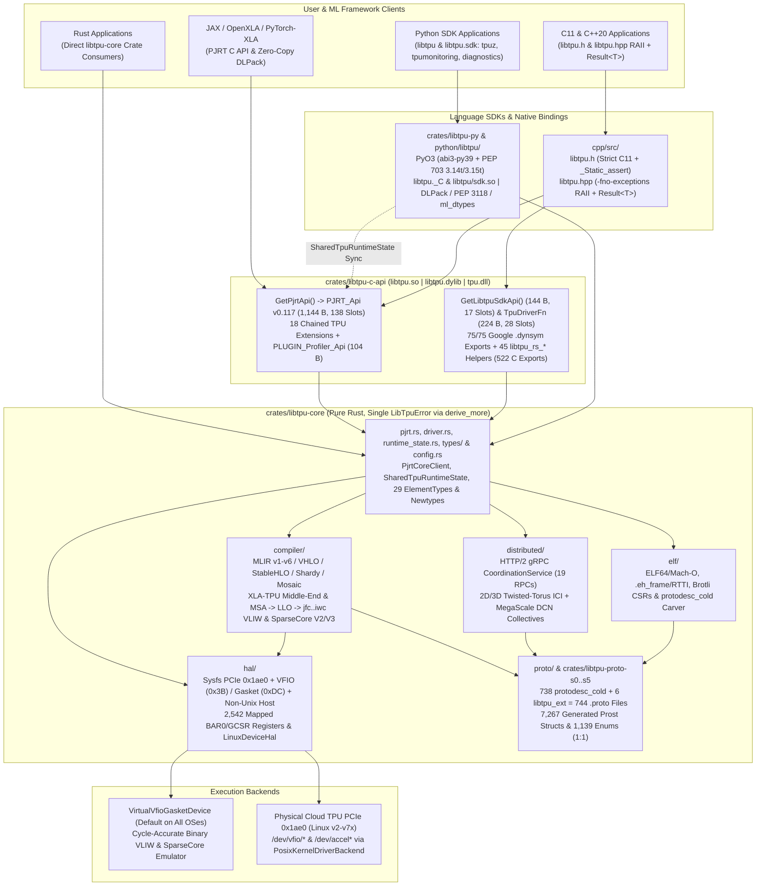

# `libtpu-rs`

[](https://opensource.org/licenses/Apache-2.0)
[](https://github.com/SamuelMarks/libtpu-rs/actions/workflows/ci.yml)
[](https://github.com/SamuelMarks/libtpu-rs/actions/workflows/release.yml)
[](#verification--quality-gates)
[](#verification--quality-gates)

**An open-source, clean-room, pure-Rust re-implementation of Google's closed-source Cloud TPU runtime (`libtpu` v0.0.53.1) — delivering binary C ABI parity, an end-to-end MLIR/XLA-TPU/VLIW/SparseCore compiler stack, a built-in architectural TPU emulator, and native Rust, C11, C++20, and Python (`PyO3` + live `jax`) SDKs across Linux, macOS, and Windows.**

[What Is It?](#what-is-libtpu-rs) · [Who Is It For?](#who-is-this-for) · [Comparison vs. Google `libtpu`](#how-libtpu-rs-compares-to-googles-official-libtpu) · [File Sizes](#binary--wheel-file-size-comparison) · [Architecture](#what-it-does--architecture) · [ABI & Symbol Tables](#abi-versions-mapped-symbols--schema-tables) · [Quick Start](#quick-start) · [Verification](#verification--quality-gates)

---

## What Is `libtpu-rs`?

Every time **JAX**, **OpenXLA**, or **PyTorch/XLA** runs on a Google Cloud TPU, it dynamically loads Google's proprietary `libtpu` Python wheel (`libtpu.so` + `sdk.so`, ~468 MiB unpacked, `manylinux_2_31_x86_64` only). That single closed-source C++ binary implements the OpenXLA PJRT plugin, XLA-TPU compiler, low-level VLIW & SparseCore code generators, distributed coordination/ICI/MegaScale runtime, Linux `VFIO`/`Gasket` PCIe driver layer, and TPU monitoring SDK.

**`libtpu-rs` replaces that proprietary black box with auditable, dual-licensed (`Apache-2.0 OR MIT`) pure Rust.** Built from scratch against ground-truth ELF64 forensics, carved `protodesc_cold` protobuf descriptors, decompressed hardware CSR maps, and OpenXLA PJRT specifications for **`libtpu==0.0.53.1`**, it exports the exact C ABI (`GetPjrtApi` v0.117, all 18 chained PJRT extensions, `GetLibtpuSdkApi`, and all 75 Google `libtpu.so` dynamic symbols) alongside first-class Rust, C11, C++20, and Python SDKs.

> [!NOTE]
> **Current Verification Boundary (Emulator vs. Bare-Metal Cloud TPU)**:
> - **Verified end-to-end today**: Live `jax` execution (`jnp.matmul` `f32`/`bf16`, `lax.dot_general`, `lax.conv_general_dilated`, `jit`/`grad`/`vmap`, `scan`/`while_loop`/`cond`, 4-chip `shard_map` collectives, `pallas_call` Mosaic kernels, `jax.pure_callback`, Transformer SGD steps, and `jax.profiler` `XPlane` capture), C11/C++20 RAII suites (including ASan/LSan/UBSan), and 100%-covered Rust/Python suites run on the built-in cycle-accurate **`VirtualVfioGasketDevice`** emulator across Linux, macOS, and Windows.
> - **Linux hardware driver status**: The non-simulated `LinuxDeviceHal` (`VFIO` `0x3B` and `Gasket` `0xDC` ioctls, sysfs PCIe `0x1ae0` discovery, IOMMU/hugepage/`dma-buf`, BAR0/GCSR register programming, and MSI-X `eventfd` completion via `create_default_hal()`) is implemented and unit-tested against synthetic sysfs/ioctl backends; `PJRT_Client_Create` currently defaults to `LinuxDeviceHal<VirtualVfioGasketDevice>` while bare-metal Cloud TPU pod bring-up and production XLA performance tuning remain active frontiers.

---

## Who Is This For?

| Target Audience | Why Use `libtpu-rs`? |
| :--- | :--- |
| **JAX / OpenXLA / PyTorch-XLA Engineers** | Prototype, test, and profile TPU-targeted `shard_map`, `pallas_call` (Mosaic), `PJRT` extensions, and `jax.profiler` traces locally on **macOS (`arm64`), Linux (`x86_64` / `aarch64`), or Windows (`x86_64`)** — with zero Cloud TPU VM provisioning and Python `>=3.9` support. |
| **ML Compiler & Accelerator Researchers** | Study, modify, and benchmark a fully open-source MLIR Bytecode v1–v6 / VHLO / StableHLO / Shardy / Mosaic → XLA-TPU middle-end & MSA → LLO → 6-generation VLIW (`jfc`–`iwc`) & SparseCore V2/V3 compiler backed by all 744 `.proto` schemas and 2,542 mapped hardware CSRs. |
| **Rust & C11 / C++20 Systems Developers** | Link a zero-external-C++-dependency, panic-free Rust core (`libtpu-core`), strict `-std=c11` ABI header (`cpp/src/libtpu.h`), or `-fno-exceptions -fno-rtti` C++20 RAII + monadic `Result<T>` SDK (`cpp/src/libtpu.hpp`) with zero `.unwrap()` and a single `LibTpuError` enum. |
| **TPU Hardware & Forensics Contributors** | Build on reproducible ELF64/Mach-O, `protodesc_cold`, Brotli CSR, Ghidra headless lifting, and PJRT differential-oracle tooling (`scripts/`) to advance clean-room Cloud TPU driver bring-up. |

---

## How `libtpu-rs` Compares to Google's Official `libtpu`

| Dimension | Google `libtpu` (`v0.0.53.1`, Official) | `libtpu-rs` (`v0.0.53.1`, Clean-Room Rust) |
| :--- | :--- | :--- |
| **License & Source** | Closed-source proprietary binary (PyPI wheel only) | **Open-source**, dual-licensed **`Apache-2.0 OR MIT`** |
| **Implementation Language** | Proprietary C++ (`537,404` `.eh_frame` FDEs, `752,460` internal ELF symbols) | **Pure Rust** (Edition 2024, `rustc >= 1.85`, 33 external crates, zero C++ runtime dependencies) |
| **Memory & Panic Safety** | Unaudited C++ memory/exception boundary | Zero `.unwrap()` / `.expect()` / `panic!()` / `anyhow` / `thiserror`; single 125-variant `LibTpuError` (`derive_more`); 100% `ffi_catch_unwind` on every `extern "C"` boundary |
| **OS & CPU Architectures** | **Linux `x86_64` only** (`manylinux_2_31_x86_64`) | **Cross-platform**: Linux (`x86_64`, `aarch64`), macOS (`arm64`), Windows (`x86_64-pc-windows-msvc`) — CI-tested across all three OSes |
| **Python ABI & Versions** | CPython `3.11`–`3.15` (`7` per-version wheels: `cp311`–`cp315`, `cp314t`/`cp315t`) | CPython **`>=3.9`** via single **`abi3-py39`** wheel + PEP 703 free-threaded **`cp314t`/`cp315t`** (`Py_MOD_GIL_NOT_USED`) |
| **Language SDKs & Interop** | Python (`libtpu` + nanobind `sdk.so`) + undocumented C symbols | **Rust** (`libtpu-core`), **C11** (`libtpu.h`), **C++20** (`libtpu.hpp` RAII + `Result<T>`), **Python** (`PyO3` + PEP 561 `.pyi` stubs + zero-copy DLPack, PEP 3118, NumPy/`ml_dtypes`) |
| **Offline / Local Execution** | Requires physical Cloud TPU PCIe hardware on Linux (`/dev/vfio` or `/dev/accel`) | Built-in cycle-accurate **`VirtualVfioGasketDevice`** emulator works everywhere (plus Linux `VFIO`/`Gasket` PCIe `0x1ae0` HAL and non-Unix anonymous BAR/event pipes) |
| **PJRT C ABI Compatibility** | `PJRT_Api` `v0.117` (`1,144` B, `138` slots), `18` extensions, `75` `.dynsym` C exports | **100% binary ABI parity** (`PJRT_Api` `v0.117`, `18` extensions, `75/75` `.dynsym` exports) + `LIBTPU_PJRT_API_MINOR_VERSION` down-negotiation (`-1..=256`) for older `jaxlib` releases |
| **Core Library Size** | `libtpu.so`: **`430.97 MiB`** (`451,904,656` B) | Release `libtpu.dylib`: **`32.42 MiB`** unstripped (**`13.3×` smaller**) / **`25.52 MiB`** stripped (**`16.9×` smaller**) |
| **Python Wheel Size** | `129.98 MiB` compressed (`~468.2 MiB` unpacked) | **`25.75 MiB`** compressed (`114.04 MiB` unpacked on macOS; **`5.0×` smaller**, and even smaller on Linux) |
| **Introspection & Testing** | No source, no public test suite, no schema/CSR/LLO inspection API | 100% doc + 100% line/function/branch coverage; 45 ergonomic `libtpu_rs_*` C/Python introspection helpers (CSR lookup, LLO disassembler, proto schema emission, register-alloc/remat reports) |
| **Production Pod Maturity** | Google's battle-tested production compiler & bare-metal pod driver | Clean-room implementation verified against live `jax` on `VirtualVfioGasketDevice`; bare-metal Cloud TPU pod bring-up and full XLA autotuning parity remain ongoing work |

### Binary & Wheel File Size Comparison

Official Google sizes are from [`docs/reverse_engineering/golden_binary_manifest.json`](docs/reverse_engineering/golden_binary_manifest.json) and [`docs/reverse_engineering/python_api.md`](docs/reverse_engineering/python_api.md) (`libtpu-0.0.53.1-cp311-cp311-manylinux_2_31_x86_64.whl`). `libtpu-rs` sizes are directly measured on `aarch64-apple-darwin` using Cargo's default `--release` profile (no LTO or `opt-level = "z"` tuning applied yet):

| Artifact | Official Google `libtpu` (`v0.0.53.1`, Linux `x86_64`) | `libtpu-rs` (`--release`, macOS `arm64`) | `libtpu-rs` (`--release` + `strip -x`) | Reduction vs. Official |
| :--- | ---: | ---: | ---: | :---: |
| **Primary Runtime Library** (`libtpu.so` / `libtpu.dylib`) | `451,904,656` B (`430.97 MiB`) | `33,994,624` B (`32.42 MiB`) *(DEFLATE: `7.47 MiB`)* | `26,757,936` B (`25.52 MiB`) *(DEFLATE: `6.83 MiB`)* | **`13.3×` – `16.9×` smaller** |
| **Python Native SDK** (`sdk.so` / `liblibtpu_py.dylib`) | `37,925,248` B (`36.17 MiB`) *(FT: `36.17 MiB`)* | `25,551,696` B (`24.37 MiB`) *(DEFLATE: `5.36 MiB`)* | `21,063,648` B (`20.09 MiB`) *(DEFLATE: `4.94 MiB`)* | **`1.5×` – `1.8×` smaller** |
| **Packaged Python Wheel** (`.whl`, compressed) | `136,292,813` B (`129.98 MiB`) | `27,002,019` B (`25.75 MiB`)¹ | *~`12–18 MiB` est. stripped/Linux* | **`5.0×` smaller** *(unstripped macOS)* |
| **Unpacked Wheel Payload** | `~490.9 MB` (`~468.2 MiB`) | `119,575,399` B (`114.04 MiB`)¹ | — | **`4.1×` smaller** |
| **C++20 RAII Static Library** (`liblibtpu_cpp.a`) | *Not provided* | `451,840` B (`0.43 MiB`) *(debug)* | — | — |
| **Rust Static Library** (`libtpu.a`) | *Not provided* | `158,764,432` B (`151.41 MiB`) | — | — |

> **Where does `libtpu-rs`'s `25.52 MiB` (stripped) go?**
> Mach-O section inspection (`size -m`) of stripped release `libtpu.dylib` shows **`12.17 MiB`** of compiled `__text` machine code (covering the entire compiler, 7,267 protobuf codecs, HAL, emulator, distributed runtime, and C ABI) and **`10.15 MiB`** of read-only `__const` data — dominated by the embedded `prost-reflect` binary `FileDescriptorSet` (`~6.4 MiB`) and [`csr_register_map.json`](docs/reverse_engineering/csr_register_map.json) (`2.6 MiB`).
>
> ¹ On macOS, `scripts/maturin_backend.py` packages both `libtpu.dylib` and a `libtpu.so` alias (plus `_C.abi3.so` and `sdk.so`) inside the wheel for drop-in path compatibility; on Linux, `libtpu.so` is already the native library name and is stored only once, saving another `~7.5 MiB` compressed (`~32.4 MiB` uncompressed). *(Unoptimized local `target/debug/` builds are `93.93 MiB` for `libtpu.dylib`, of which `44.58 MiB` is `__LINKEDIT` debug symbol metadata.)*

---

## What It Does & Architecture

`libtpu-rs` implements the complete vertical software stack of a Cloud TPU runtime inside a 9-crate Rust workspace:

- **OpenXLA PJRT C API & Multi-Version Negotiation**: Full `PJRT_Api` `v0.117` (`1,144` B, `138` function slots) plus all **18 chained TPU extensions**, `LibtpuSdk_Api` `v0.1` (`144` B, `17` slots), `TpuDriverFn` (`224` B, `28` slots), and legacy TensorFlow TPU symbols (`TfTpu_*`, `TpuStatus_*`, `TpuTopology_*`, `TpuProfiler_*`, `TpuEmbeddingEngine_*`). Setting `LIBTPU_PJRT_API_MINOR_VERSION` cleanly down-negotiates older PJRT minor versions (`-1..=256`, e.g., `54` for JAX 0.4.x).
- **MLIR / VHLO / StableHLO / Shardy / Mosaic Compiler Pipeline**:
  - **Frontend**: Upstream-compliant **MLIR Bytecode v1–v6** (`ML\xefR`) reader/writer, `winnow` textual MLIR & XLA HLO parsers, `chlo` legalizer, portable `vhlo` (`v0.9.0`–`v1.11.0+`) upgrade/downgrade, `sdy` (Shardy) meshes/shardings, JAX `tpu` (Mosaic/Pallas) ops, and lossless `StableHLO` ↔ `xla.HloModuleProto` bridging.
  - **XLA-TPU Middle-End & Memory Space Assignment**: `ShardyPropagationPass`, `GspmdPartitionerPass`, `DotDecomposerPass`, `ConvolutionLegalizerPass`, `(8, 128)` / `(16, 256)` `TpuLayoutAssignmentPass`, `MxuTilingPass` (`128×128` `v2`–`v5p`, `256×256` `v6e`/`v7x`), producer-consumer & multi-output fusion, `HloRematerializationPass`, `MemorySpaceAssignmentPass` (`HBM`/`VMEM`/`SMEM`/`CMEM` + async ping-pong DMA), `GlobalDecreasingSizeBestFitHeapSimulator`, and `MiddleEndCostModelEvaluator`.
  - **Low-Level Optimizer (LLO) & Generation-Exact Binary ISA Codecs**: `LloIr`, `SwingModuloPipeliner`, `LloRegisterAllocator` (with VMEM/SMEM spill splicing), 6-generation VLIW encoders/disassemblers (`JellyfishIsaCodec` `jfc`, `DragonfishIsaCodec` `dfc`, `PufferfishIsaCodec` `pfc`, `ViperfishIsaCodec` `vfc`, `GhostfishIsaCodec` `gfc`, `IronwoodIsaCodec` `iwc`), **SparseCore / BarnaCore V2 (`16` B) & V3 (`24` B)** codecs with all **19** gradient optimizers, Riegeli `HighwayHash64` framing, and 5-phase `PJRT_PhaseCompile` (`PJRT_Relocatable_*`).
- **Hardware Abstraction Layer, Real CSR Maps & Cycle-Accurate Emulator**:
  - Sysfs PCIe `0x1ae0` discovery (`v2`–`v7x`), Linux `VFIO` (`0x3B`) & `Gasket` (`0xDC`) ioctl drivers, buddy/slab HBM & hugepage/IOMMU/`dma-buf` management, **2,542** mapped BAR0/GCSR register offsets, and non-Unix anonymous BAR/event-pipe abstractions for macOS & Windows.
  - **`VirtualVfioGasketDevice`**: Executes compiled binary VLIW & SparseCore bitstreams over `[8, 128]` VPU lanes, `128×128`/`256×256` MXU systolic arrays, and demand-paged `4 KiB` sparse HBM (up to `192 GiB`), emitting hardware `XPlane` trace records.
- **Distributed Coordination, 2D/3D Twisted-Torus ICI & MegaScale DCN**:
  - Wire-compatible HTTP/2 + Protobuf gRPC client & server for all **19** `tensorflow.CoordinationService` RPCs.
  - Deadlock-free 2D torus and 3D twisted-torus ICI routing and multi-rank `CollectiveCommunicator` (`AllReduce`, `ReduceScatter`, `AllGather`, `AllToAll`, `CollectivePermute`, `RaggedAllToAll`) across all **29 `ElementType`s** (`Pred`, `S2`/`U2`, `S4`/`U4`, `FP4` `F4E2M1FN`, all 6 `FP8` formats including `F8E8M0FNU`, `BF16`, `F16`, `F32`, `F64`, `C64`, `C128`), plus multi-socket TCP/DCN MegaScale transport and `CrossHostTransferRegistry`.
- **Unified Process-Wide Telemetry & Multi-Language SDKs**:
  - `SharedTpuRuntimeState` synchronizes live HBM usage, DMA byte counters, compile/execute counts, debug callbacks, and `XSpace` profiler traces across both `libtpu.so` (`ctypes`/C/C++) and `libtpu._C` / `sdk.so` (`PyO3`).



See **[`ARCHITECTURE.md`](ARCHITECTURE.md)** for the full architectural deep dive and **[`USAGE.md`](USAGE.md)** for complete Rust, C11, C++20, Python, and JAX guides.

---

## ABI Versions, Mapped Symbols & Schema Tables

### 1. Binary ABI & Wire Protocol Versions

| Interface / Protocol | Version / Identifier | Struct Size | Slots / Entries | Verification Method |
| :--- | :--- | :---: | :---: | :--- |
| **Upstream Target Package** | Google `libtpu` **`0.0.53.1`** | — | SHA-256 `9b098d86...bcb3dc8` | [`golden_binary_manifest.json`](docs/reverse_engineering/golden_binary_manifest.json) |
| **`PJRT_Api` (Core Vtable)** | **`v0.117`** (`major=0, minor=117`; negotiable `-1..=256` via `LIBTPU_PJRT_API_MINOR_VERSION`) | `1,144` B (`0x478`) | `138` function slots (`0x028..0x470`) | Rust `offset_of!`, C11 `_Static_assert`, C++20 `static_assert`, `ctypes` ABI hook |
| **`PJRT_Api_Version` Header** | `major=0, minor=117` | `24` B (`0x18`) | `4` fields | Compile-time layout assertions |
| **`PJRT_Extension_Base` Chain** | `18` linked TPU extensions | `24` B header + payload | `157` struct slots (`150` active in `libtpu.so`, `162` golden fns incl. profiler) | Runtime linked-list walk in `pre_commit.py abi` |
| **`PLUGIN_Profiler_Api`** | `0.0.53.1` XSpace Profiler API | `104` B (`0x68`) | `11` function slots | Struct layout & C11/C++20/JAX profiler tests |
| **`LibtpuSdk_Api`** | **`v0.1`** (`major=0, minor=1`) | `144` B (`0x90`) | `17` function slots (`0x08..0x88`) | Runtime vtable walk in `pre_commit.py abi` |
| **`TpuDriverFn`** *(Legacy Driver)* | Legacy `TpuDriver` C ABI | `224` B (`0xe0`) | `28` function slots | Runtime vtable walk in `pre_commit.py abi` |
| **TPU Runtime Base ABI** | **`167`** (`compiler_hash` `f84a06ff...`) | `972` B (`current_tpu_runtime_abi.binarypb`) | Per-gen hardware ABIs `0x10000` (`v2`/`v3`), `0x10001` (`v4`–`v5e`), `0x10003` (`v5p`–`v7x`) | [`csr_register_map.json`](docs/reverse_engineering/csr_register_map.json) |
| **MLIR Bytecode & VHLO** | `ML\xefR` **`v1`–`v6`**, VHLO **`v0.9.0`–`v1.11.0+`** | — | `builtin`, `vhlo`, `stablehlo`, `chlo`, `sdy`, `tpu` (Mosaic) | Unit & live `jax` compilation suites |
| **CPython Native Extension ABI** | **`abi3-py39`** (`>=3.9`) + **PEP 703** (`cp314t`/`cp315t`) | — | `Py_MOD_GIL_NOT_USED` slot on `Py_GIL_DISABLED` | Wheel smoke-tests in `.github/workflows/release.yml` |
| **Tensor Interchange Protocols** | **DLPack**, **PEP 3118**, **NumPy `__array_interface__` v3** | — | All **29** OpenXLA `ElementType`s (`ml_dtypes` `bf16`/`fp8`/`fp4`/`int4`) | `python/tests/test_libtpu.py` & `test_phase11_python_sdk.py` |

---

### 2. Mapped & Exported Symbol Inventory

#### 2A. Google `libtpu.so` (`v0.0.53.1`) `.dynsym` Function Parity — **75 / 75 (100%)**

Every global dynamic function symbol (`STT_FUNC`) exported by Google's official `libtpu.so` is implemented and dynamically verified via `ctypes.CDLL` in [`scripts/pre_commit.py`](scripts/pre_commit.py):

| Symbol Family | Official `libtpu.so` | `libtpu-rs` Mapped | Parity | Representative Symbols |
| :--- | :---: | :---: | :---: | :--- |
| **PJRT & SDK Entrypoints** | `2` | `2` | **100%** | `GetPjrtApi`, `GetLibtpuSdkApi` |
| **TF / StreamExecutor / Runtime Hooks** | `8` | `8` | **100%** | `TfTpu_Initialize`, `TF_InitKernel`, `TFNPD_InitPlugin`, `SetGlobalTPUArrayOp_DoWork`, `SparseCore_GetMaxIdsAndUniques` |
| **Ordinal Selector (`TfTpuOrdinalSelector_*`)** | `4` | `4` | **100%** | `Create`, `Destroy`, `GetOrdinal`, `DequeueFromCoreSelector` |
| **Status (`TpuStatus_*`)** | `7` | `7` | **100%** | `New`, `Create`, `Set`, `Free`, `Message`, `Code`, `Ok` |
| **Topology, Host & Core Location (`TpuTopology_*`, `TpuCoreLocation_*`, `TpuHostLocation_*`, `TpuUtil_*`)** | `26` | `26` | **100%** | `TpuUtil_GetTopologyPtr`, `TpuTopology_Version`, `TpuTopology_Core`, `TpuCoreLocation_ChipCoordinates`, `TpuHostLocation_Cores` |
| **MeshState & Profiler (`TpuMeshState_*`, `TpuProfiler_*`)** | `8` | `8` | **100%** | `TpuMeshState_Create`, `TpuProfiler_Create`, `TpuProfiler_Start`, `TpuProfiler_Stop`, `TpuProfiler_CollectData` |
| **TPU Embedding Engine (`TpuEmbedding*`)** | `20` | `20` | **100%** | `ExecutePartitioner`, `ConfigureMemory`, `CollateMemory`, `WriteParameters`, `ReadParameters`, `EnqueueTensorBatch`, `RecvActivationsComputation` |
| **Total Official `libtpu.so` `.dynsym` Functions** | **`75`** | **`75`** | **100%** | Verified in [`docs/reverse_engineering/exported_symbols.md`](docs/reverse_engineering/exported_symbols.md) |

#### 2B. Complete `libtpu-rs` Native Export Surface — **522 C Exports (`libtpu-c-api`) + 3 CPython Initializers (`libtpu-py`)**

In addition to dispatching through vtables, `libtpu-c-api` exports the underlying C symbols directly for C11/C++20 static & dynamic linking, legacy compatibility, and runtime introspection:

| Crate / Artifact | Export Category | Symbol Count | Notes |
| :--- | :--- | :---: | :--- |
| **`libtpu-c-api`** (`libtpu.so` / `.dylib` / `tpu.dll`) | Official Google `libtpu.so` `.dynsym` functions | `75` | 100% match against `golden_binary_manifest.json` |
| **`libtpu-c-api`** | Core `PJRT_Api` vtable implementations (`PJRT_*`) | `138` | All 138 slots in `GLOBAL_PJRT_API` |
| **`libtpu-c-api`** | Chained PJRT extension functions (`PJRT_*`) | `162` | All 18 extension vtable functions + `PJRT_Extension_ValidateArgs` / `PJRT_Triton_Compile` |
| **`libtpu-c-api`** | `PLUGIN_Profiler_Api` functions (`PLUGIN_Profiler_*`) | `11` | `Error_*`, `Create`, `Destroy`, `Start`, `Stop`, `CollectData`, `Serialize`, `Consume`, `ConsumeResult_Destroy` |
| **`libtpu-c-api`** | `LibtpuSdk_Api` functions (`LibtpuSdk_*`) | `18` | 17 vtable slots + `LibtpuSdk_TriggerDebugCallbacks` |
| **`libtpu-c-api`** | Legacy `TpuDriver` C API (`TpuDriver_*`) | `32` | `Initialize`, `Open`, `Close`, plus all 28 `TpuDriverFn` slots & helpers |
| **`libtpu-c-api`** | Extended TF/Mesh/LLO/PJRT utility hooks | `40` | `ConfigureDistributedTpuOp_DoWork`, `TpuCompile_*`, `TpuNodeContext_*`, `PJRT_CheckMatchingStructSizes`, deleters |
| **`libtpu-c-api`** | Ergonomic `libtpu_rs_*` C/C++/Python helpers | `45` | CSR lookup, LLO disassembler, proto schema emitter, BarnaCore runner, gRPC/ICI/remat diagnostics |
| **`libtpu-c-api`** | Embedded `PyInit_sdk` compatibility export | `1` | C-ABI fallback symbol alongside `libtpu-py` |
| **`libtpu-c-api` Subtotal** | **Total `#[unsafe(no_mangle)] extern "C"` symbols** | **`522`** | Zero-panic `ffi_catch_unwind` on every entrypoint |
| **`libtpu-py`** (`_C` / `sdk.so`) | Native `PyO3` PEP 489 / PEP 703 module initializers | **`3`** | `PyInit__C`, `PyInit_sdk`, `PyInit_libtpu_py` (`slice`, `tpumonitoring`, `tpuz`, `debug`, `diagnostics`) |

---

### 3. Complete 18-Node PJRT Extension Chain (`GetPjrtApi()->extension_start`)

Exact linked-list order, `PJRT_Extension_Type` discriminants, byte sizes, and slot counts verified against `libtpu==0.0.53.1` ([`golden_struct_layouts.json`](docs/reverse_engineering/golden_struct_layouts.json)):

| Order | Extension Struct | `ext_type` | Size (Bytes) | Struct Slots | Active in `libtpu.so` | Role |
| :---: | :--- | :---: | :---: | :---: | :---: | :--- |
| `1` | `PJRT_FFI_Extension` | `5` (`0x05`) | `48` | `3` | `3` | `xla::ffi` custom-call type & handler registration |
| `2` | `PJRT_XlaTransform_Extension` | `24` (`0x18`) | `56` | `4` | `4` | Custom XLA pass registration, listing & execution |
| `3` | `PJRT_HostMemoryAllocator_Extension` | `23` (`0x17`) | `32` | `1` | `1` | Pinned host DMA memory allocator handle |
| `4` | `PJRT_MultiSlice_Extension` | `22` (`0x16`) | `64` | `5` | `5` | Multi-slice config queries & serialization |
| `5` | `PJRT_Collectives_Extension` | `21` (`0x15`) | `96` | `9` | `9` | Multi-rank `AllReduce`, `ReduceScatter`, `AllGather`, `AllToAll`, `CollectivePermute` |
| `6` | `PJRT_AbiVersion_Extension` | `20` (`0x14`) | `120` | `12` | `12` | Runtime & executable ABI compatibility & proto codecs |
| `7` | `PJRT_Shardings_Extension` | `19` (`0x13`) | `40` | `2` | `2` | Serialized `xla.OpSharding` parameter/output queries |
| `8` | `PJRT_Megascale_Extension` | `18` (`0x12`) | `288` | `33` | `28` | Multi-slice DCN context, topology, barriers, slice discovery & telemetry |
| `9` | `PJRT_TpuExecutable_Extension` | `17` (`0x11`) | `96` | `9` | `8` | `HloModuleProtoWithConfig`, memory stats, cost analysis & compilation env |
| `10` | `PJRT_TpuTopology_Extension` | `16` (`0x10`) | `280` | `32` | `32` | Subslice topology, chip/core/host coordinates, routing strategy & ICI reachability |
| `11` | `PJRT_Callback_Extension` | `14` (`0x0e`) | `40` | `2` | `2` | Host callback registration & invocation |
| `12` | `PJRT_PhaseCompile_Extension` | `9` (`0x09`) | `192` | `21` | `21` | 5-phase compilation & `PJRT_Relocatable_*` compile/deserialize/link |
| `13` | `PJRT_CrossHostTransfers_Extension` | `12` (`0x0c`) | `56` | `4` | `4` | Cross-host buffer send/receive & remote-device copies |
| `14` | `PJRT_ExecutableMetadata_Extension` | `13` (`0x0d`) | `40` | `2` | `2` | Serialized executable metadata query & teardown |
| `15` | `PJRT_MemoryDescriptions_Extension` | `6` (`0x06`) | `40` | `2` | `2` | Generation-specific memory space descriptions (`HBM`, `VMEM`, `pinned_host`) |
| `16` | `PJRT_Layouts_Extension` | `4` (`0x04`) | `80` | `7` | `7` | Tiled device/parameter/output OpenXLA HLO layout serialization |
| `17` | `PJRT_RawBuffer_Extension` | `8` (`0x08`) | `80` | `7` | `7` | Raw HBM alias buffers with offset H2D/D2H transfers |
| `18` | `PJRT_Profiler_Extension` | `1` (`0x01`) | `40` | `2` | `1` (+ `11` in `PLUGIN_Profiler_Api`) | `PLUGIN_Profiler_Api` (`104` B) live `XSpace` capture + `traceme_context_id` |
| **Total** | **18 Linked Extensions** | — | **`1,688` B** *(+ `104` B profiler)* | **`157`** | **`150`** *(+ `11` profiler = `162` golden fns)* | **100% struct-size, `ext_type`, and slot parity** |

---

### 4. 1:1 Protobuf Schema Synchronization (`protox` + `prost-build`)

All schemas compile directly into Rust `OUT_DIR` via 6 Tarjan-SCC workspace shards (`crates/libtpu-proto-s0..s5`), keeping peak `rustc` RSS bounded while preserving zero hand-written `*Proto` structs (enforced bidirectionally by `scripts/pre_commit.py proto-sync`):

| Schema Source | `.proto` Files | Generated Rust Structs (`prost::Message`) | Generated Rust Enums | Notes |
| :--- | :---: | :---: | :---: | :--- |
| [`docs/reverse_engineering/protos/`](docs/reverse_engineering/protos/) | `738` | `7,187` | `1,139` | Topologically closed `protodesc_cold` carve (`2,972,184` B section @ `0x145296c0` in `libtpu.so`), covering all 293 TPU/XLA/HLO/PJRT/Shardy/DeepSea/SparseCore/MegaScale/XPlane/Coordination domain schemas + transitive imports |
| [`protos/libtpu_ext/`](protos/libtpu_ext/) | `6` | `80` | `0` | Canonical `proto3` schemas (`deepsea_ext`, `hlo_passes`, `megascale_ext`, `pjrt_ext`, `tpu_ext`, `xplane_ext`) for pure-Rust compiler/runtime wire metadata |
| **Total (1:1 Synchronized)** | **`744`** | **`7,267`** | **`1,139`** | `0` hand-written `*Proto` structs; `0` unregistered messages; runtime `prost-reflect` + canonical ProtoJSON/textproto transcoding |

---

### 5. Supported Cloud TPU Generations (`v2`–`v7x`) & Hardware CSR Maps

All 8 Cloud TPU architectures modeled in [`crates/libtpu-core/src/types/hardware.rs`](crates/libtpu-core/src/types/hardware.rs) and [`docs/reverse_engineering/csr_register_map.json`](docs/reverse_engineering/csr_register_map.json) (all under Google PCIe Vendor ID `0x1ae0`):

| Generation | Codename / ISA | ASIC Family | PCIe Device ID | Kernel Driver | Hardware ABI | MXU Array | HBM / Logical Device | VMEM / Core | TensorCores / SparseCores (per Chip) | Static `.lrodata` CSRs | Mapped BAR0/GCSR Registers |
| :--- | :--- | :---: | :---: | :--- | :---: | :---: | :---: | :---: | :---: | ---: | ---: |
| **TPU v2** | Jellyfish (`jfc`) | `jxc` | `0x0027` | Gasket (`0xDC`) | `0x10000` (`65536`) | `128×128` | `8 GiB` (`16 GiB`/chip) | `16 MiB` | `2` / `0` *(BarnaCore)* | `3,808`¹ | `102` |
| **TPU v3** | Dragonfish (`dfc`) | `jxc` | `0x0027` | Gasket (`0xDC`) | `0x10000` (`65536`) | `128×128` | `16 GiB` (`32 GiB`/chip) | `16 MiB` | `2` / `0` *(BarnaCore)* | `3,808`¹ | `102` |
| **TPU v4** | Pufferfish (`pfc`) | `pfc` | `0x0056` | Gasket / VFIO | `0x10001` (`65537`) | `128×128` | `32 GiB` | `32 MiB` | `2` *(Megacore)* / `4` | `25,388` | `107` |
| **TPU v4lite** | Pufferfish Lite (`pfc`) | `plc` | `0x005e` | VFIO (`0x3B`) | `0x10001` (`65537`) | `128×128` | `16 GiB` | `16 MiB` | `1` / `0` | `11,619` | `48` |
| **TPU v5e** | Viperfish Lite (`vfc`) | `vlc` | `0x0063` | VFIO (`0x3B`) | `0x10001` (`65537`) | `128×128` | `16 GiB` | `32 MiB` | `1` / `2` | `7,964` | `31` |
| **TPU v5p** | Viperfish (`vfc`) | `vfc` | `0x0062` | VFIO (`0x3B`) | `0x10003` (`65539`) | `128×128` | `95 GiB` | `64 MiB` | `2` *(Megacore)* / `4` | `52,644` | `1,078` |
| **TPU v6e** | Ghostfish / Trillium (`gfc`) | `glc` | `0x006f` | VFIO (`0x3B`) | `0x10003` (`65539`) | `256×256` | `32 GiB` | `64 MiB` | `1` / `2` | `37,094` | `551` |
| **TPU7x** | Ironwood (`iwc`) | `gfc` | `0x0076` | VFIO (`0x3B`) | `0x10003` (`65539`) | `256×256` | `192 GiB` | `64 MiB` | `2` *(Megacore)* / `4` | `56,412` | `523` |
| **Total** | **6 ISA Codecs** | **7 Families** | **8 Gen SKUs** | **VFIO + Gasket** | **3 HW ABIs** | — | — | — | — | **`194,929` unique** (`198,737` summed¹) | **`2,542`** |

> ¹ `TPU v2` and `TPU v3` share the same `3,808`-entry `jxc` static CSR table (`198,737 - 3,808 = 194,929` unique static CSR descriptors across all generations).

---

## Quick Start

### 1. Rust Workspace (`rustc >= 1.85`, Edition 2024)

```bash
cargo build --workspace --all-targets
cargo test --workspace --all-targets
```

### 2. Drop-In Python Wheel & Live JAX Integration (Python `>=3.9`)

```bash
pip install -e .
pytest python/tests/test_jax_integration.py -v
```

```python
import libtpu

# Point JAX / OpenXLA at the compiled pure-Rust libtpu shared library
libtpu.configure_library_path()
libtpu.set_init_args("--tpu_generation=v6e", "--tpu_chips_per_host_bounds=2,2,1")

import jax
import jax.numpy as jnp

dev0 = jax.devices("tpu")[0]
x = jax.device_put(jnp.array([[1.0, 2.0], [3.0, 4.0]], dtype=jnp.bfloat16), dev0)
print(jax.jit(lambda m: jnp.matmul(m, m))(x))
```

### 3. C11 & C++20 Zero-Exception SDK (`-fno-exceptions -fno-rtti`)

```bash
cmake -B cpp/build -S cpp -DENABLE_COVERAGE=ON
cmake --build cpp/build
ctest --test-dir cpp/build --output-on-failure
```

For full Rust, C11, C++20, Python `libtpu.sdk` (`tpumonitoring`, `slice`, `tpuz`, `debug`, `diagnostics`), and environment-variable examples, see **[`USAGE.md`](USAGE.md)**.

---

## Repository Layout

| Path | Scale | Description |
| :--- | :---: | :--- |
| [`crates/libtpu-core/`](crates/libtpu-core/) | `89` files · `127.6K` lines | Pure-Rust core: `LibTpuError` (`125` variants), `29` `ElementType`s & checked newtypes, `SharedTpuRuntimeState`, MLIR/VHLO/StableHLO/Shardy/Mosaic frontend, XLA-TPU middle-end & MSA, LLO + 6-gen VLIW & SparseCore V2/V3 codecs, `LinuxDeviceHal` + `VirtualVfioGasketDevice` + non-Unix host layer, HTTP/2 gRPC `CoordinationService` + 2D/3D ICI + MegaScale, and ELF64/Mach-O forensics. |
| [`crates/libtpu-c-api/`](crates/libtpu-c-api/) | `42` files · `48.5K` lines | ABI-exact `#[repr(C)]` C FFI (`libtpu.so` / `.dylib` / `tpu.dll` / `libtpu.a`): `GetPjrtApi` `v0.117`, all 18 chained extensions, `GetLibtpuSdkApi`, `TpuDriver_*`, `TfTpu_*`, and 45 `libtpu_rs_*` helpers (`522` C exports, 100% `ffi_catch_unwind`). |
| [`crates/libtpu-py/`](crates/libtpu-py/) | `3` files · `2.5K` lines | `PyO3` (`abi3-py39` + PEP 703 `Py_MOD_GIL_NOT_USED` free-threaded `3.14t`/`3.15t`) native CPython extensions (`libtpu._C`, `libtpu/sdk.so`) + zero-copy `DLManagedTensor` capsule bridge. |
| [`crates/libtpu-proto-s0..s5/`](crates/proto_codegen_shared.rs) | `13` files · `1.2K` lines | 6 Tarjan-SCC protobuf shard crates compiling all 744 `.proto` schemas 1:1 into `7,267` `prost::Message` structs and `1,139` enums. |
| [`cpp/`](cpp/) | `6` files · `12.0K` lines | Two-level CMake project (`cpp/CMakeLists.txt` + `cpp/src/CMakeLists.txt`), strict C11 header (`libtpu.h`) with `_Static_assert` tests (`test_libtpu_c11.c`), and zero-exception C++20 RAII + monadic `Result<T>` SDK (`libtpu.hpp`, `libtpu.cpp`, `test_libtpu.cpp`). |
| [`python/libtpu/`](python/libtpu/) & [`python/tests/`](python/tests/) | `21` files · `14.8K` lines | Drop-in `libtpu` + `libtpu.sdk` (`tpumonitoring`, `slice`, `tpuz`, `debug`, `diagnostics`), PEP 561 `.pyi` stubs, PEP 3118 / NumPy (`ml_dtypes`) / DLPack interop, 100% branch-covered unit tests, and live `jax` numerical parity suite (`test_jax_integration.py`). |
| [`protos/libtpu_ext/`](protos/libtpu_ext/) | `6` `.proto` files | Canonical `proto3` extension schemas compiled 1:1 alongside `protodesc_cold`. |
| [`docs/reverse_engineering/`](docs/reverse_engineering/) | `738` `.proto` + manifests | Ground-truth `protodesc_cold` `.proto` tree, `csr_register_map.json` (`V2`–`V7x`), `golden_binary_manifest.json`, `golden_struct_layouts.json`, `golden_proto_descriptors.json`, and ABI specifications. |
| [`scripts/`](scripts/) | `8` files · `7.2K` lines | `pre_commit.py` quality gate, `maturin_backend.py` PEP 517 wheel assembler, `fetch_artifacts.py`, `sync_oss_anchors.py`, `re_extract.py`, `ghidra_lift_isa_and_abi.py`, and `differential_oracle.py`. |

---

## Verification & Quality Gates

Every commit is gated by [`scripts/pre_commit.py`](scripts/pre_commit.py) and [`.github/workflows/ci.yml`](.github/workflows/ci.yml) across Linux (`ubuntu-latest`), macOS (`macos-latest`), and Windows (`windows-latest`), enforcing:

- **100.0% Documentation Coverage**: Across every file, module, struct/class/enum, field, function, and parameter in Rust (`cargo doc` `-D missing_docs` + nightly `rustdoc --coverage` JSON + AST `# Arguments` / `# Safety` auditor), Python (`ruff` Google pydocstyle `D` + AST parameter/return auditor across `.py` & `.pyi`), and C11/C++20 (`doxygen` `WARN_AS_ERROR = YES`, `WARN_NO_PARAMDOC = YES` + XML parameter auditor).
- **100.0% Function, Line, and Branch/Region Test Coverage**: Verified via `cargo +nightly llvm-cov --workspace --branch` (Rust), `pytest --cov=libtpu --cov=scripts --cov-branch --cov-fail-under=100` (Python: `5,557/5,557` statements, `1,824/1,824` branches, including live `jax`), and `llvm-profdata` + `llvm-cov` + ASan/LSan/UBSan (C11/C++20: `1,954/1,954` lines, `265/265` functions, `122/122` branches, `498/498` regions), with zero `coverage(off)` on production code and zero `# pragma: no cover`.
- **Strongest Lints, Zero Panics & Single `derive_more` Error Enum**:
  - Workspace [`Cargo.toml`](Cargo.toml) enforces `all`, `pedantic`, `nursery`, and `cargo` Clippy lints at `deny`, and **`forbid`**s `missing_docs`, `unsafe_op_in_unsafe_fn`, `unwrap_used`, `expect_used`, `panic`, `todo`, `unimplemented`, `unreachable`, `dbg_macro`, `missing_docs_in_private_items`, `missing_errors_doc`, `missing_panics_doc`, `missing_safety_doc`, and `undocumented_unsafe_blocks` (with AST scans extending zero-`unwrap`/zero-`panic!` even into `#[cfg(test)]` and `build.rs`).
  - Zero `anyhow`, `thiserror`, `eyre`, `miette`, or `snafu`: every fallible Rust API returns `Result<T, LibTpuError>` powered solely by `derive_more`.
  - Python passes `mypy --strict` (including shadowed `.py`/`.pyi` pairs) and `ruff check`; C11/C++20 build cleanly under `-Wall -Wextra -Wpedantic -Wconversion -Wsign-conversion -Wshadow -Wnull-dereference -Wformat=2 -Werror` (`-fno-exceptions -fno-rtti` for C++20).
- **1:1 Protobuf Sync (`proto-sync`) & Binary ABI Gate (`abi`)**: Verifies bidirectional field/tag parity across all `744` `.proto` files (`7,267` structs, `1,139` enums) and dynamically inspects the compiled shared library via `ctypes.CDLL` across all `75` Google `libtpu.so` exports, `138` `PJRT_Api` `v0.117` slots, all `18` chained PJRT extension descriptors, `LibtpuSdk_Api` (`144` B), and `TpuDriverFn` (`224` B).

Run the entire 7-stage local verification suite with:

```bash
python3 scripts/pre_commit.py all --check
```

---

## License

Licensed under either of:

- Apache License, Version 2.0 ([`LICENSE-APACHE`](LICENSE-APACHE) or <http://www.apache.org/licenses/LICENSE-2.0>)
- MIT license ([`LICENSE-MIT`](LICENSE-MIT) or <http://opensource.org/licenses/MIT>)

at your option.

### Contribution

Unless you explicitly state otherwise, any contribution intentionally submitted
for inclusion in the work by you, as defined in the Apache-2.0 license, shall be
dual licensed as above, without any additional terms or conditions.
